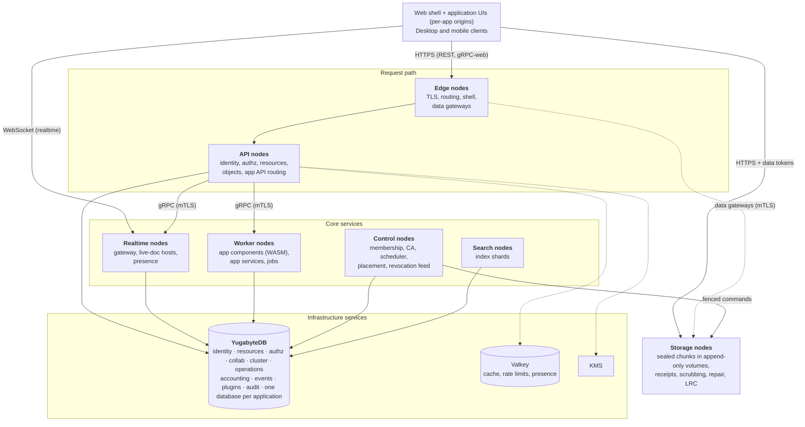

# Cloud System — Workspace Platform Specification

- Version: 2.4.2 (v2.4 plus approved errata C1–C13, recorded in docs/SPEC_ERRATA.md)
- Status: Normative architecture specification and source of truth for implementation
- Part 1 of 4: sections 1–9 (platform, resources, identity, authorization, applications, data, integration).
- Part 2: sections 10–16 (collaboration, events, search, sync, UI, security, reference applications).
- Part 3: sections 17–27 (storage, metadata, cluster, scalability, recovery, operations, research decisions).
- Part 4: normative appendices A–M (threat model, failure matrix, consistency rules, API errors, schema conventions, lifecycle state machine, SDK, targets, SLOs, deployment, restore verification, upgrade tests).

## 1. Introduction

### 1.1 Purpose

Cloud System is a self-hosted, modular workspace platform written in Rust for Linux. A shared core provides identity, permissions, sharing, storage, versioning, synchronization, search, real-time collaboration and administration. Applications — Drive, Photos, Documents, Sheets, Slides, Notebooks, Calendar, Mail, Contacts, Meet, Chat, Forms, Sites, Tasks, Notes and future ones — are installed as plugins on top of that core. Each application offers its own experience, and all of them share one identity, one permission model, one storage layer and one integration fabric.

The same software runs on a single machine or across a large distributed cluster. A single node is the smallest configuration of the distributed design, not a separate implementation.

### 1.2 Goals

- A neutral core: the core contains no application business logic. Every user-facing application, including Drive, is a plugin. The only user-facing components the core ships are platform components (section 3.5): the shell, sign-in, administration and shared UI components, which serve every application and implement no application's functionality.
- Consistency across applications: one account, one permission and sharing model, one search, one notification system, one trash and version history model.
- Extensibility: new applications are added without changes to the core. They define their own data models, services, APIs and UI.
- Composability: plugins build on each other through explicit, versioned dependencies. A plugin reuses the capabilities another plugin exports instead of duplicating them (Photos builds on Drive; Documents, Sheets, Slides and Notebooks build on Drive; Meet integrates with Calendar).
- Loose coupling: plugins integrate only through exported interfaces, events, extension points and resource references, never through each other's internals.
- Correctness and durability: published data is complete, verified and never silently lost.
- Security: passwords never reach the server, data is encrypted at rest, optional end-to-end encrypted vaults, strict tenant and application isolation.
- Scalability: every subsystem scales horizontally by adding nodes, without application changes.
- Operability: observable, upgradable without downtime, recoverable from disasters.

When goals conflict, they are prioritized in this order: correctness, durability, security, availability, performance.

### 1.3 Scope

In scope: the core platform, the plugin system, the storage subsystem, real-time collaboration, synchronization, search, the web shell and native clients, cluster operation, backup and recovery. Section 16 describes how the reference applications use the platform; their detailed functional design belongs to each application's own specification.

Out of scope for version 2: cross-tenant deduplication, active-active multi-region writes (a recovery site is supported, section 23), a public S3-compatible API.

### 1.4 Normative language

- MUST / MUST NOT: mandatory invariants. No configuration can disable them.
- SHOULD: recommended defaults that operators may change, with documented consequences.
- Policy: a configurable parameter, listed with its default and safe range. Where this document gives only a default, the safe range is defined by erratum C13 (docs/SPEC_ERRATA.md); a value outside its range is rejected at configuration load.
- Decision status: this specification defines the target architecture. Implementation plans, migration records, review history and unresolved engineering tasks are maintained separately and are not part of this document.

### 1.5 Terminology

- Tenant: an organization that owns users, groups, applications, policies and quotas. Tenants are isolated from each other.
- Principal: a user, group, guest, service identity or application identity.
- Resource: any addressable object managed by the platform on behalf of an application: a file, folder, document, spreadsheet, album, calendar, event, mailbox, message, chat channel, form, site, task list, note, and so on.
- Resource type: a kind of resource, registered by the application that owns it (for example docs.document).
- Space: the root of a resource hierarchy: a personal space, a shared space or an application-private space.
- Application: a plugin that provides a user-facing experience. Extension: a plugin that adds capabilities to other applications. Both are plugin packages.
- Interface: a named, versioned contract (operations, events or UI capabilities) that a plugin provides or consumes.
- Dependency: a declared relationship from one plugin to another plugin (by plugin ID and version range) or to an interface (satisfied by any provider). Dependencies are required or optional.
- Export: the public surface a plugin offers to others: interfaces, events, resource types, permissions and extension points. Everything else in a plugin is internal.
- Extension point: a named place where a provider plugin accepts contributions from other plugins (for example Drive's "containable types" or "open-with handlers").
- Object: a versioned binary content stream stored by the object storage subsystem (section 17).
- Chunk, seal, extent: units of object storage (section 17.1).
- Live document: a resource whose content is a collaboratively edited CRDT state (section 10).
- Domain: an independent logical database within the metadata store (section 18).
- Epoch: a monotonically increasing number that fences out stale actors.
- DB time: YugabyteDB hybrid logical clock time. ε: the maximum clock uncertainty between any node and DB time.
- Vault: a space whose content is end-to-end encrypted by clients.

## 2. Platform Architecture

### 2.1 Layers

The platform has three layers:
1. Infrastructure layer: the metadata store (YugabyteDB), the object storage subsystem (storage nodes), the cache (Valkey), the key management system and the cluster control plane.
2. Core platform layer: application-independent services built on the infrastructure:
   - Identity and directory (section 5).
   - Authorization and sharing (section 6).
   - Resource registry: the shared hierarchy of spaces and resources, trash, retention, versions and links (section 4).
   - Object storage API (section 17).
   - Application data services: per-application relational storage, settings and caches (section 8).
   - Real-time gateway and live documents (section 10).
   - Event bus, notifications, activity and discussions (sections 9.7 and 11).
   - Search (section 12).
   - Synchronization (section 13).
   - Application runtime and lifecycle management (section 7).
   - Web shell and UI SDK (section 14).
   - Administration, audit and quotas.
3. Application layer: plugin packages that provide applications and extensions. They use the core only through its public APIs and SDKs.
The core knows resource types, permission schemas, interfaces and UI surfaces only as data declared by applications. It never contains code specific to Drive, Mail or any other application.

### 2.2 Node roles

**All server roles ship in one binary and are enabled per node**

- Edge: TLS termination, routing, the web shell, static assets, data gateways for storage traffic (section 17.6).
- API: core REST/gRPC APIs, authorization checks, token issuing, upload sessions, application API routing.
- Realtime: WebSocket gateway and live-document hosts (section 10).
- Worker: application runtimes — WebAssembly components and services (section 7.3) — and core background jobs.
- Search: index shards and query execution (section 12).
- Storage: object storage on local disks (section 17).
- Control: membership, cluster certificate authority, scheduler partitions, placement, revocation feed, plugin acquisition (section 20).

YugabyteDB, Valkey and the KMS run alongside. A single-node deployment enables every role on one host.

### 2.3 Architecture diagram



### 2.4 Request lifecycle

1. The client calls the edge with an access token.
2. The edge routes core API calls to API nodes, and application API calls (/apps/{app-id}/...) to API nodes that forward to the application's runtime.
3. The API node authenticates the token, resolves the tenant and principal, and evaluates permissions through the authorization service.
4. Core operations run in core services. Application operations run in the application's components or services, with a capability context limited to the caller's rights (section 7.4).
5. File content flows directly between clients and storage nodes using data-plane tokens. Live-document edits flow through the realtime gateway.
6. Every state change emits events through transactional outboxes. Events drive search indexing, notifications, activity, sync feeds and application integrations.

### 2.5 Deployment shapes

- Single node: every role on one host, LRC disabled, replicas across local disks. It protects against disk failures only; section 17.3.1 states its durability guarantees and why recovery-site replication or off-host backup is required for host-level protection.
- Small cluster (3–16 storage nodes): mixed roles per node, YugabyteDB replication factor 3, node-level failure domains.
- Large cluster: dedicated nodes per role, scaled independently (section 21), rack- or zone-level failure domains.
- Minimum sizes and guarantees for each shape are defined in section 17.3.1 and appendix J.

### 2.6 Platform-wide correctness contracts

Every subsystem implements the following contracts. These contracts take precedence over any local optimization or cache behavior.

**Authority**

- Every durable fact has exactly one authoritative owner and serialization point, listed in appendix C. A cache, search index, event, replica, inventory or application projection is never authoritative merely because it is locally available.
- An operation identifies its authoritative pivot: the single committed state transition after which the operation is logically effective. Acknowledgements state whether the request was accepted, committed at its pivot, or fully completed including required post-pivot work.

**Durability**

- Acknowledged durable writes survive every failure within the advertised effective failure tolerance. A write is not acknowledged as durable while it has only been accepted into memory, a queue, a socket buffer or an unsynced filesystem cache.
- Publication readiness is distinct from eventual target redundancy. Every published object satisfies its configured publication durability contract; background repair may restore a higher steady-state target but cannot retroactively make a weaker publication safe.
- Deployment status exposes actual durability by disk, host, rack, zone and site, including degraded state and remaining failure tolerance.

**Visibility**

- Data becomes user-visible only after all referenced content and required metadata have crossed their publication pivots. Derived systems may lag, but stale derived state must never grant access or expose content that the authoritative state denies.
- Removal of visibility precedes physical reclamation. No timeout, missing event, lost response or absent metadata record is sufficient evidence to delete data.

**Consistency**

- Cross-domain causality is represented by authenticated, bounded vectors of authoritative positions and explicit dependencies. Independent database clocks are not comparable. An enforcement point that cannot satisfy a required vector returns unavailable, never a stale allow.
- Every multi-domain workflow is a durable saga with a unique idempotency key, an explicit pivot, pre-pivot compensation, post-pivot forward recovery and a level-triggered reconciler.

**Recovery**

- A service is ready only after it has restored or rebuilt its authoritative state to a causally closed recovery vector, applied required revocations, reconciled operations and verified its dependencies. Process health alone never establishes readiness.
- Backups, archives, inventories, keys, event offsets, plugin artifacts and audit checkpoints have explicit ownership and recovery contracts. Recovery claims are limited to the data classes actually covered.

**Security and revocation**

- Authorization is evaluated against authoritative relationship and membership state or a verified snapshot at least as fresh as the request's consistency vector. Every enforcement point has an explicit stale-state behavior and measurable denial bound.
- Long-lived streams and transfers are continuously subject to revocation. Token expiry alone does not terminate an already-authorized transfer.

**Resource and failure isolation**

- Capacity, CPU, memory, I/O, database tablet budgets, queues and network budgets are isolated by tenant and workload class. A subsystem cannot consume repair or control-plane reserves.
- Single-host redundancy, node redundancy, rack/zone redundancy and site recovery are distinct guarantees and are never presented as interchangeable.

## 3. Core Responsibilities and Boundaries

### 3.1 What the core owns

- Tenants, principals, authentication, sessions and the directory.
- The permission model, permission evaluation, sharing and revocation.
- The resource registry: identity, hierarchy, ownership, lifecycle state (appendix F), retention, legal hold and resource links.
- Object storage: chunking, encryption, durability, versions, tiers, quotas.
- Platform data services offered to applications: relational storage, settings, caches, queues.
- Live-document infrastructure: sessions, CRDT persistence, presence and history.
- Cross-cutting services: events, notifications, activity, discussions (comments), search, synchronization, previews framework, audit.
- Application lifecycle: installation, permissions, runtime, isolation, upgrades and rollback.
- Platform components (section 3.5): the web shell, sign-in and account pages, administration console, shared UI components, UI SDK and native client frameworks.

### 3.2 What applications own

- Their resource types, data schemas and business logic.
- Their APIs, events and provided interfaces.
- Their user interface and the experience inside it.
- Their own services (for example a mail transfer agent or a media server).
- Their data migrations and export formats.

### 3.3 Boundary rules

- The core MUST NOT depend on any application. Removing every application leaves a working core with administration only.
- Applications MUST NOT access another application's database, objects, services or UI internals. They integrate only through exports reached through declared dependencies: interfaces, events, extension points and resource references (sections 7.9 and 9).
- The core resolves dependencies, enforces them and brokers every inter-plugin call. It never implements a plugin's functionality on the plugin's behalf.
- Applications MUST NOT implement their own authentication, permission storage, sharing or file storage. They declare permission schemas (section 6.2) and use core storage (section 8).
- Every operation an application performs on core data goes through core APIs, with the authorization of the acting principal.
- First-party applications follow the same rules and use the same public APIs as third-party ones.
- Platform components are part of the core, not plugins. They are privileged in one respect only: they run on the platform's own origin and render core functions (sign-in, sharing, administration). They use the same public APIs as applications and contain no application business logic.

### 3.4 Core API surface

- Public client API: REST over HTTPS, versioned by major version (/api/v2), described by an OpenAPI schema; gRPC-web for streaming endpoints.
- Realtime protocol: WebSocket, versioned (section 10.1).
- Application host API: WIT packages (cs:platform/*), semantically versioned, used by WebAssembly components and, through a gRPC binding, by native services.
- SDKs: Rust (components and services), TypeScript (web UI), plus generated clients for the REST API.
- Compatibility rules: section 24. Error responses: appendix D.

### 3.5 Platform components

The core ships these user-facing components. They are core code, released and versioned with the core, and are not plugins:

- Web shell: launcher, global navigation, search box, notifications, account menu and routing (section 14.1).
- Sign-in, account, security and recovery pages.
- Administration console: tenants, users, groups, policies, plugins, dependency plans, quotas, audit, cluster health.
- Shared UI components used inside applications: share dialog, resource and people pickers, comment threads, version history, activity panel, upload and preview viewer (section 14.3).
- UI SDK and native client frameworks (sections 14.3 and 14.5).

**Boundary rules**

- Platform components implement only core functions. A feature specific to one kind of content (for example a photo grid or a spreadsheet editor) belongs to a plugin, even if every deployment installs that plugin.
- Platform components run on the platform origin and are the only code that does, except full-mode plugins explicitly approved by an administrator (section 14.2).
- Plugins extend platform components only through declared extension surfaces (for example settings pages, launcher entries, notification renderers), never by patching them.

## 4. Resource Model

### 4.1 Resources

Every application object that users can name, share, find, trash or link to is a resource registered in the core resource registry.

**A resource record contains**

- Resource ID: 128-bit UUIDv7, globally unique. Its URN is cs:{tenant}:{type}:{id}.
- Type: a registered resource type (section 4.2).
- Space and parent: its position in the hierarchy (section 4.3).
- Name, owner, creator, creation and modification times.
- Lifecycle state (appendix F): creating, active, trashed, purging or purged; retention and legal-hold flags.
- Content binding (optional), one of:
  - an object (versioned binary content, section 17);
  - a live document (section 10);
  - application records (rows in the owning application's database, section 8.3).
- ACL version and inheritance flag (section 6).
- Metadata: core-defined fields plus typed application metadata (JSON validated against a schema the type declares).

The record is authoritative for identity, hierarchy, lifecycle and permissions. The owning application is authoritative for type-specific content.

### 4.2 Resource types

**An application declares its resource types in its manifest**

- Name (namespaced by application, for example photos.album), display names and icons.
- Content binding kind: object, live document, application records, or none (pure containers).
- Whether it is a container and which child types it accepts.
- Permission schema reference (section 6.2).
- Lifecycle behavior: versioned or not, trashable or not, default retention.
- Visibility: shown in the shared hierarchy (for example in Drive) or application-private.
- Interfaces the type supports: preview, export formats, search extraction, embed.

A type cannot be removed while resources of that type exist. Removing the owning application follows section 7.5.

### 4.3 Hierarchy and spaces

- Spaces are the roots: each user has a personal space; tenants create shared spaces for teams; each application can have private spaces for data users do not browse directly (for example mail storage).
- Resources form a tree under their space: containers (folders, albums, notebooks of notes) hold other resources.
- Namespace writes are partitioned by stable resource and parent identifiers, not by a single tenant-wide counter or parent-row lock. Folder-entry tables are hash-bucketed once their size or write rate crosses a measured threshold. Large subtree operations use bounded, resumable batches with a durable operation record; the parent/child relationship pivot is explicit.
- A move or rename changes the authoritative parent/name tuple in one resources-domain transaction and emits one journal/outbox record. Descendant rows are not rewritten merely because an ancestor moves. Snapshot reconstruction derives scope membership from parent relationships at the selected cut.
- Listing cursors identify the folder, ordering, filter, last stable key, authorization snapshot requirement and expiry; they do not encode physical bucket layout. Live listing consistency and exact snapshot listing guarantees are defined in section 19.3.
- Resources of many types share the tree. The core owns spaces only. Containers are plugin types: Drive provides drive.folder and drive.file (object-backed files) and exports a "containable types" extension point. Plugins that depend on Drive (Documents, Sheets, Slides, Notebooks, Forms) register their types there, so a Drive folder can hold files, documents, spreadsheets and forms side by side, and Drive's file management (browse, move, copy, trash, sync, share) works for all of them. Other plugins can provide their own containers (for example Photos albums, which hold references).
- Moving a resource changes its parent and is subject to permissions on both source and destination. Moves across spaces are allowed when the types and policies of both spaces permit them.
- Resources can appear in collections without being moved (for example a photo in several albums): collections hold references (section 4.5), not ownership.

### 4.4 Lifecycle, trash, versions and retention

- Trash: deleting a resource moves it, with its subtree, to trash. Trashed resources keep their permissions and can be restored by users with the required permission until the tenant's trash retention expires (policy, default 30 days). Purge then removes them and their content.
- Versions: types with object or live-document content have version history. Object versions follow section 17; live-document history follows section 10.7. Version retention is a tenant policy (default 30 days, at most 100 versions per resource) and applications can request longer retention for their types.
- Retention and legal hold: tenant administrators can apply retention rules or legal holds to spaces or resources. Held resources cannot be purged, and their versions cannot expire.
- Purge safety: purge MUST respect snapshots (section 19.2), legal holds, the read grace period and the recovery window (section 17.9).
- The owning application receives lifecycle events (trashed, restored, purged) and must clean up its own records on purge. If it does not, the core still removes the resource and its core-managed content; orphaned application records are reported to the application and to administrators.

### 4.5 References and links

- A resource reference is (resource URN, optional version, optional anchor), where an anchor is an application-defined location inside the resource (a cell range, a time in a video, a message).
- References are how applications relate resources: an email attachment, a chat file share, a calendar event's linked agenda document, a photo in an album, an embedded chart in a slide.
- The core stores references in a link index. It can therefore answer "what links here", and it notifies the referencing applications when a target is trashed, restored or purged.
- Following a reference always requires permission on the target. A reference never grants access by itself; sharing does (section 6.5).

### 4.6 Resource events

Every resource change emits a typed event through the resources domain outbox: created, updated, moved, renamed, trashed, restored, purged, permissions changed, version published. These events drive search, sync, notifications, activity and application integrations (section 11).

## 5. Identity

### 5.1 Principals and tenants

- Users belong to one home tenant. Guests are external users invited into a tenant with restricted capabilities (policy).
- Groups contain users and other groups (nesting allowed, cycles rejected). Group membership is stored in the identity domain and expanded through a cached closure (section 6.4).
- Service identities represent automation inside a tenant. Application identities represent installed applications (section 7.4).
- Tenant policies cover password and MFA requirements, session lifetimes, sharing limits (external sharing, link sharing), retention, quotas, enabled applications and data residency.

### 5.2 Password authentication: OPAQUE with Argon2id

- Passwords are verified with OPAQUE (RFC 9807): ristretto255-SHA512 OPRF, 3DH key exchange, HKDF-SHA-512 and HMAC-SHA-512. The server never receives the password.
- Argon2id (RFC 9106) is the mandatory key-stretching function, run on the client. Defaults: 64 MiB, 3 iterations, parallelism 1, tuned to about one second on the slowest supported devices; parameters are stored per registration and upgraded at the next successful login.
- The OPRF seed and server key-exchange keys are versioned, held in the KMS and loaded into API node memory only. Users move to the newest version by transparent re-registration after login.
- Unknown accounts get indistinguishable responses. Attempts are rate limited per account and per source.
- OPAQUE's export key, known only to the client, unlocks the user's vault key bundle (section 15.7).

### 5.3 Passkeys and multi-factor authentication

- Users can register WebAuthn credentials. They serve as a second factor after OPAQUE, or for passwordless sign-in with discoverable passkeys. Tenants can require MFA.
- Where the authenticator supports the WebAuthn PRF extension, a PRF-derived key can add one more wrapper of the vault bundle key. It is never the only wrapper (section 15.7).

### 5.4 Single sign-on

- OIDC and SAML identity providers are configured per tenant, either in the core or through identity-provider extensions. SSO users have no OPAQUE export key and unlock vaults by device approval or recovery key.
- SCIM provisioning keeps users and groups in sync with an external directory.

### 5.5 Sessions and tokens

- A sign-in creates a session in the identity domain.
- Access tokens: Ed25519 JWS, default lifetime 10 minutes, carrying session ID (sid), subject, tenant, authorization version, authentication strength and, when the client uses DPoP (RFC 9449), the key thumbprint (cnf.jkt). DPoP is mandatory for third-party OAuth clients and optional for first-party clients (policy).
- Refresh tokens: random 256-bit values stored as SHA-256 hashes, single use with rotation. Reuse of a rotated token revokes the whole session. Web clients receive them in Secure, HttpOnly, SameSite=Strict cookies scoped to the refresh endpoint. Native clients bind them to a device key.
- Sessions have an idle lifetime (default 14 days) and an absolute lifetime (default 90 days).
- Sensitive operations (credential, MFA and recovery changes, vault membership, administration, sharing outside the tenant) require authentication no older than 5 minutes (policy).
- Applications never see refresh tokens or passwords. Third-party clients and application integrations use OAuth 2.0 with scopes mapped to interfaces (section 9.1).

### 5.6 Account recovery

Account recovery restores the ability to sign in. It never restores vault keys.

- Methods: an account recovery code (Argon2id-hashed, shown once); approval from a signed-in device or registered passkey; verified email with a waiting period (default 24 hours, cancellable from any device); administrator-assisted recovery under the same waiting period.
- Users with MFA must also present a second factor or their recovery code.
- Completing recovery sets a new OPAQUE registration, revokes all sessions and notifies all devices.

### 5.7 Directory

- The core directory lists users, groups and guests of the tenant, with profile fields (name, photo, title, department, manager) and presence status.
- Applications read it through the cs:platform/directory interface, filtered by tenant policy (for example guests see only people they collaborate with).
- Personal and shared address books are the Contacts application's data. Contacts provides the contacts interface that Mail, Calendar and Chat consume (section 9.1); the core directory remains the source for tenant members.

## 6. Authorization and Sharing

### 6.1 Model

Authorization is relationship-based, in the style of Google Zanzibar: permissions derive from relationships between principals and resources, and from relationships between resources (such as parent).

- Relationship tuples have the form (resource, relation, subject), where the subject is a principal, a group membership (group#member) or another resource's relation (folder#viewer).
- Transaction boundary: relationship tuples on a resource are stored in the resources domain, in the same tablet group as the resource (keyed by resource ID). A tuple write and the resource's ACL-version bump and namespace-journal entry are therefore one local transaction. Group-membership tuples (group#member) are stored with the group in the identity domain, in one transaction with the group's membership version.
- Permission schemas, share-role mappings and the revocation feed log are in the authz domain. They change through outbox events from the resources and identity domains (for revocation records) or through plugin installation (for schemas). No authorization write spans two domains.
- The authz domain maintains a versioned materialized authorization projection of resource tuples, parent/inheritance relations, group membership closure and permission schemas. Resources and identity remain authoritative; the projection is derived and records the exact source positions it has applied. Authorization decisions use one consistent read snapshot of this projection rather than independently reading multiple source databases during each check.
- Projection updates are idempotent, ordered per source partition and applied with their source position in the same authz transaction. A projection watermark is valid only when all source partitions are contiguous through the advertised positions. Independent database-cluster timestamps are never treated as causally comparable.
- Authorization MUST be checked for every API call, application host call, data-plane token issue, realtime channel join, search result and sync feed entry.

### 6.2 Permission schemas

Each resource type has a permission schema, declared by its application and validated at install time:

- Relations: for example owner, editor, commenter, viewer, plus type-specific ones (calendar: free_busy_reader; form: responder; chat channel: member).
- Permissions as expressions over relations, including inheritance through parent: view = viewer + commenter + editor + owner + parent->view.
- Share roles: a mapping from the platform's standard roles (Viewer, Commenter, Editor, Manager, Owner) to the type's relations. This makes the shared sharing dialog work for every type.
- The core defines the schema for spaces. A plugin can reference another plugin's types only through permissions that plugin exports, and only when it declares a dependency on it. For example docs.document declares view = viewer + ... + parent->view, where parent is a drive.folder and view is a permission Drive exports. Permissions therefore inherit through containers across plugin boundaries without either plugin seeing the other's internals.
- Schemas are versioned with the application. Changing a schema requires a migration plan validated at upgrade time (section 7.5).

### 6.3 Evaluation and inheritance

- check(resource, permission, principal) walks the schema: direct tuples, group membership, and inherited permissions via parent up to the first inheritance break.
- lookup(principal, permission, type, within) lists accessible resources. It is used by listings, search filtering and sync.
- Ancestor chains, per-resource ACLs and group closures are cached in-process and in Valkey, keyed by (resource ID, ACL version) and (group ID, membership version).

### 6.4 Consistency and caching

Authorization uses a single Authorization Decision Service (ADS) backed by the authz domain. The ADS is the only component that interprets cross-domain consistency vectors; API, storage, realtime, search and sync consumers use signed decisions and revocation watermarks. The authz domain stores a versioned projection of source facts and their applied positions.

- The resources domain is authoritative for resource relationships, ACL versions, parent relationships and resource generations. The identity domain is authoritative for group membership and membership versions. The authz domain is authoritative for permission schemas, schema versions, policy mappings and revocation-feed sequencing.
- Each committed authorization-affecting write returns a signed consistency context containing: tenant ID; issuer; protocol version; the exact source domain IDs and committed positions; affected resource/group/schema version identifiers; global authorization epoch; issue time; and expiry. The context is integrity-protected and audience-bound. It contains no independent-cluster timestamp used as a causal ordering primitive.
- The ADS compares the request context with the projection watermark. If any required source position is not applied, it waits for the projection or returns unavailable; it never falls back to an older projection. It evaluates the permission expression in one authz-database read transaction, giving the decision a single consistent projection snapshot. The decision records that snapshot ID, source vector, authorization epoch and expiry.
- A signed control-plane watermark heartbeat is published at least every 500 ms, even when no revocation events occur. Each enforcement consumer reports the last heartbeat received, last contiguous applied source positions and epoch. A consumer is stale if the heartbeat age exceeds S, its applied positions trail the required watermark by more than S, or any gap/epoch mismatch exists. This makes S a measurable freshness bound rather than an age counter on an idle event stream.
- A check result is keyed by tenant, resource, principal, permission, resource ACL version, group membership version, schema version and authorization epoch. Cache entries are usable only when every component is at least as fresh as the request context. Valkey and process caches are accelerators, never authorities.
- The public consistency context has a strict maximum encoded size. Large dependency sets are represented by a server-side immutable snapshot handle bound to the principal, tenant, audience and expiry; the handle resolves to a bounded vector. Expired, malformed, unknown-version or oversized contexts are rejected, not silently truncated.
- The ADS issues signed, short-lived decision tickets for storage and realtime enforcement. A ticket is bound to the exact resource/version or channel, principal, session, operation, audience, authorization snapshot, epoch and expiry. Storage/realtime nodes still enforce local revocation watermarks and stream checkpoints; a decision ticket is not a substitute for revocation delivery.
- Group closure is versioned. Membership mutations invalidate the relevant closure generation. Nested group cycles are rejected at write time; expansion has configured depth and cardinality limits. A limit breach returns a typed policy/complexity error, never a partial allow.
- Signature algorithm: every signed artifact in this specification (access tokens, data-plane tokens, consistency contexts and snapshot handles, decision tickets, revocation records and watermark heartbeats, storage receipts, state attestations and signed cursors) uses Ed25519. Each artifact type has its own domain-separation context string included in the signed bytes, and signed payloads use one canonical serialization, so a signature for one artifact type can never verify as another. HMAC-protected artifacts (for example listing cursors, section 19.3) remain HMAC.
- A write response carries the context required by subsequent dependent reads. Clients may omit it only for explicitly eventual-consistency reads that do not make authorization decisions or expose protected data.

### 6.5 Sharing

- Sharing is a core service used by every application through one API and one shared dialog component (section 14.3).
- A share grants a standard role (section 6.2) on a resource to a user, group, guest or link. It is stored as relationship tuples plus share metadata: who shared, when, optional message, optional expiry.
- Link shares: a random 128-bit token bound to a role and an optional password, expiry and audience restriction (tenant only, anyone). Opening a link resolves it to a temporary principal with that role.
- Sharing outside the tenant obeys tenant policy and can require approval.
- Sharing a container shares its subtree through inheritance. Inheritance breaks are explicit and visible in the UI.
- Notifications for shares are sent through the notification service (section 9.7).
- Attachments and references in messages (section 9.4) can offer "share on send": the sender is asked to grant recipients access to referenced resources they cannot yet see.

### 6.6 Revocation

Revocation is a control-plane protocol with a single authoritative sequence per tenant and a monotonically increasing global authorization epoch. Feed delivery, application, and actual denial are separately measured.

- Authoritative revocation is committed in the domain that owns the changed fact: resources for resource ACLs, moves, inheritance breaks and resource generations; identity for sessions, user status and group membership; plugins for capability grants and plugin lifecycle. The same local transaction writes an outbox event. The authz service consumes those events and assigns an ordered revocation sequence. No revocation is considered propagated merely because the outbox event was emitted.
- Revocation records identify the affected principal/session/group or resource subtree, the source domain and position, the new ACL/membership/resource generation, tenant authorization epoch and event ID. Subtree revocation is represented by an ancestor generation/tombstone, not by enumerating descendants.
- Every API, storage, realtime, search and sync enforcement consumer maintains an authenticated applied position and epoch. The control plane publishes a signed watermark heartbeat at least every 500 ms. Startup requires a verified signed snapshot plus contiguous replay through the control-plane readiness watermark. Feed gaps, checksum failures, epoch regression, unknown schema or loss of durable local position make the consumer stale immediately.
- Parameter S is the maximum permitted freshness lag. Default S = 2 seconds; maximum configurable S = 30 seconds. The control plane publishes a signed watermark heartbeat at least every 500 ms, including when no revocation event occurs. Consumers publish last heartbeat, last-applied source positions, feed sequence and epoch. A consumer is stale if heartbeat age exceeds S, its applied positions trail the required watermark by more than S, a sequence gap exists or an epoch mismatch occurs. S is not a feed polling interval.
- Stale API nodes fail closed for every protected request. Stale storage nodes reject all writes and new reads. Stale realtime nodes reject edits, close affected channels and stop sending protected content. Search and sync nodes stop returning protected results and become unavailable until their authorization snapshot is current. No role may use a cached allow after becoming stale.
- Existing transfers and streams are continuously checked. Storage nodes revalidate authorization at least every 1 MiB transferred or every 1 second, whichever occurs first, and before every range/resume request. Realtime gateways revalidate every channel at least once per second and on every revocation event. Upon revocation they stop sending new bytes/frames, cancel queued buffers, close the stream and reject resume tokens. Already delivered bytes cannot be recalled; after a revocation is applied locally, the server stops sending new bytes within the 1-second checkpoint interval and closes the transfer within a further 1-second termination allowance. The full exposure bound includes feed propagation S.
- Read fail-open is removed. Protected reads, writes, edits, sync entries and search results fail closed when the enforcing node cannot prove freshness. Public, explicitly non-sensitive resources may use a separate public cache policy; they are not treated as protected data.
- Token lifetime is an additional bound, not the revocation mechanism. Data-plane tokens are short-lived and bound to exact extents, resource generation, principal, session, DPoP key and authorization epoch. Storage nodes must also enforce current revocation state and transfer checkpoints.
- Revocation propagation SLO: 99% within 2 seconds and 100% within S. Unauthorized writes/edits after authoritative commit: zero. Unauthorized reads/stream frames after commit: no more than S + 1-second checkpoint interval + 1-second termination allowance. Any breach is a security incident; no error budget applies.

### 6.7 Data-plane tokens

API nodes issue narrowly scoped tokens for direct client/storage transfers.

- Tokens are Ed25519-signed, audience-bound to one storage node and contain session, subject, tenant, resource, exact version or upload session/chunk indexes, exact extent IDs, resource generation, grant reference, authorization epoch, consistency snapshot ID, expiry, unique token ID and optional DPoP key thumbprint.
- Tokens authorize a transfer capability, not a long-lived right to read. Default read lifetime is 60 seconds and write lifetime is 5 minutes. Renewal requires a fresh authorization check. Tokens cannot be broadened or replayed at another node.
- Storage-node checks include signature, issuer, audience, expiry, site epoch, tenant, DPoP, exact extent/session binding, resource generation, current revocation epoch and freshness of its applied revocation position. A stale node denies access.
- Every transfer is a cancellable stateful stream with bounded buffers. The storage node rechecks revocation at least every 1 MiB or 1 second, before range continuation and before issuing any additional response body. Revocation cancels the stream and discards queued unsent bytes.
- Ancestor paths are not embedded as unbounded raw lists. Tokens carry the resource generation and a signed ancestry snapshot handle with a maximum depth of 256. The storage node resolves it through a bounded local authorization snapshot cache; a missing or stale snapshot denies access. Short-lived fallback tokens are permitted only for explicitly public data, never as a protected-resource workaround. No resource depth within the supported limit (256, appendix H.5) uses a weaker token form.

### 6.8 Administrative roles and policy

- Roles: cluster administrator (deployment), tenant administrator, application administrator (per application), auditor (read-only audit access) and support roles defined by tenants.
- Administrative actions are authorized by the same relationship model, on the tenant and application resources.
- Policy hooks from extensions can add restrictions (for example data-loss prevention on sharing). They can deny but never grant, run under a time budget, and deny on failure unless configured otherwise.

## 7. Applications (Plugins)

### 7.1 Application model

An application is a plugin package that the core installs, runs and isolates. A package can contain:

- Declarations: resource types, permission schemas, interfaces provided and consumed, events, settings, UI surfaces, storage needs and permissions requested.
- Components: WebAssembly components that handle API requests, events, jobs and hooks.
- Services: long-running processes for protocols and workloads that need them.
- A web UI bundle.
- Live-document schemas and validators.
- Database migrations, translations and assets.

Packages that only augment other applications (for example a virus scanner or a diagram editor that registers as a viewer) are extensions. They use the same model.

### 7.2 Package and manifest

A package is a git repository with a plugin.toml manifest at its root:

- Identity: id (globally unique reverse-DNS style, for example org.example.photos), name, version (semantic versioning), authors, license, homepage, repository, signing identity.
- Compatibility: supported core versions and host-API (WIT) versions.
- Dependencies: on plugins (plugin ID and semantic-version range) and on interfaces (interface name and version range), each marked required or optional (section 7.9).
- Exports: interfaces provided (with versions), exported events, resource types and permissions, and extension points with their contribution schemas.
- Resource types, permission schemas and share-role mappings.
- Events published and subscribed.
- API routes, served under /apps/{app-id}/.
- Components and services with their resource requests and limits.
- UI: entry point, navigation entry, routes, surfaces contributed to other applications (viewers, editors, pickers, sidebar panels, settings pages) and web mode (section 14.2).
- Storage: relational database (yes/no), object storage classes, live-document types, search document types, retention defaults.
- Requested permissions (section 7.4), outbound network destinations and secrets.
- Migrations with their compatibility class (section 7.5).
- Export and import formats (section 8.5).

### 7.3 Runtime units

**Runtime trust classes (mandatory)**

- Class U — untrusted extension: WASM component with capability-only host calls, no ambient filesystem, no raw sockets, bounded fuel/memory and no direct infrastructure credentials. This is the default for third-party plugins.
- Class S — restricted service: WASM service or isolated OCI workload with gVisor; only manifest-declared network destinations and platform APIs. No host namespace, privileged device or cluster credential access.
- Class P — privileged platform integration: native service in a dedicated OS identity and sandbox, explicitly approved by the cluster administrator, signed package digest pinned, narrow RPC surface, seccomp/namespace restrictions and independent resource budget.
- Class X — user-code execution: Firecracker microVM per execution boundary (or equivalent hardware-assisted isolation), ephemeral filesystem and credentials, no ambient platform authority. Notebook kernels and arbitrary user code MUST use this class.
- Full-mode UI is equivalent to privileged shell code and is not an ordinary plugin class. It requires separate digest approval and user activation under section 14.2.
- Approval records identify trust class, package digest, requested capabilities, network policy, data classes reachable, signer and approval expiry. Changing any of these requires fresh approval. Admin approval does not replace sandboxing.

**Components (default)**

- WebAssembly components targeting WASI 0.3, run by Wasmtime in dedicated worker processes.
- Used for request handlers, event handlers, scheduled and background jobs, policy hooks, search extractors, preview generators and live-document validators.
- Each invocation gets a fresh or reset instance from a pooling allocator, with limits on memory, CPU (fuel or epoch interruption), wall-clock time and I/O sizes.
- The scheduler reserves hard per-tenant and per-plugin budgets for component memory/fuel/CPU, invocation concurrency, service replicas, native memory, file descriptors, outbound connections, database connections, cache bytes, event throughput, scheduled jobs and storage. Aggregate reservations MUST fit allocatable capacity plus mandatory failure, repair and compaction headroom; otherwise enablement is refused. Plugin-count limits are not capacity guarantees.
- Components talk to the core only through the host API (cs:platform/* WIT interfaces), so every call is authorized against the invocation's capability context.

**Services**

- Long-running units for workloads that cannot be expressed as short invocations: protocol servers (SMTP, IMAP, CalDAV, CardDAV), media servers (WebRTC SFU, TURN), computation kernels (notebook execution) and long-lived connections to external systems.
- WebAssembly services (preferred): long-running WASI 0.3 components with socket access limited to declared ports and destinations.
- Native services: OCI container images, only when the workload needs native code (media processing, language runtimes for user code). They run under the core service supervisor on worker nodes:
  - rootless, in a gVisor sandbox by default;
  - in a Firecracker microVM, or an equivalently isolated microVM, whenever they execute user-supplied code (for example notebook kernels);
  - with cgroup limits, a read-only image, declared volumes from core storage and network policies (section 15.5).
- Services reach the core through the host API's gRPC binding with mutual TLS and an application identity. They have no direct access to the metadata store, Valkey or storage nodes.
- Services declare their scaling model: singleton per tenant, sharded by key, or stateless replicas. The supervisor places, restarts and scales them, using the same leases and fencing as core schedulers (section 20). Native services run rootless under gVisor by default; user-supplied code MUST run in a microVM and MUST NOT share the host-kernel namespace with core services.
- Deployments that allow no native services can disable them. Applications that require them then cannot be installed.

**UI bundle**

- Static ES modules and assets served from the application's origin (section 14.2).

**Live-document schemas**

- Document type definitions for the CRDT engine, with optional validator components (section 10.2).

### 7.4 Capabilities and permissions

- An application receives exactly the permissions its manifest requests and an administrator approves. Approval covers the whole request; updates that request more need approval again.
- Permission classes:
  - Platform capabilities: resources of its own types (always), reading other types through interfaces, directory read, notifications send, events publish and subscribe, search publish, object storage, relational database, live documents, outbound network (listed hosts or any), secrets, services (WebAssembly or native, sandbox level), scheduled jobs, CLI commands.
  - High-risk capabilities: acting on all users' resources without a user present (for example for compliance scanning), tenant-wide directory write, identity provider, authorization policy hooks, full-mode web UI (section 14.2), native services running user code.
- Capability approval is versioned and auditable. A package update that adds, broadens or changes the meaning of a capability requires fresh approval. Revocation blocks new host calls, cancels or revalidates queued jobs, terminates affected service instances and invalidates delegated grants. Outbound network restrictions are enforced at the network layer.
- Every invocation runs with a capability context:
  - Acting principal: the requesting user for routes and UI calls; the event's subject or the application identity for events; the recorded delegation for jobs.
  - Effective rights: the intersection of the application's granted permissions, the acting principal's rights and the resources in scope.
  - Resources are passed as unforgeable handles; host functions check authorization on every call.
- Jobs created on behalf of a user store a delegation (user, scope, expiry). The user's current rights and the current capability grant are checked again when the job runs and before every privileged step; queued jobs are cancelled or revalidated when a capability is revoked.
- Applications act on resources of other applications only through those applications' interfaces or through core resource and object APIs, always with the acting principal's permissions.

### 7.5 Lifecycle

**Installation**

- An administrator installs a package from a git URL and ref. An isolated fetcher clones it (shallow, pinned commit, no hooks, submodules or LFS, HTTPS only, size and resource limits) and validates the manifest, components, images and UI bundle. Nothing from the repository is executed during installation.
- The core resolves dependencies into an installation plan (section 7.9.3), checks compatibility and permission requests for every plugin in the plan, shows them to the administrator grouped by risk, and records each approved package (commit, digests of every file, image digests, signer identity) in the plugin registry. The validated package is stored in cluster object storage; native service images are mirrored into the cluster's image store.
- Migrations run, resource types and schemas are registered, and the application is enabled for the selected tenants or groups.

**Enablement**

- Applications are enabled per tenant, and optionally per group within a tenant. Enabling a plugin enables its required dependencies for the same scope (section 7.9.4). Disabled applications keep their data; their UI, routes and handlers are unavailable; their resources remain visible in the shared hierarchy as read-only items that cannot be opened (policy: hidden instead).

**Upgrades**

- A new version is fetched and validated like an installation. Permission increases require approval. The resolver checks the new version against every dependent's declared ranges and produces a coordinated upgrade plan when dependents must move together (section 7.9.5).
- Migrations follow expand–migrate–contract and MUST keep the previous version operable until the contract step:
  - expand migrations are additive;
  - contract migrations run only after the previous version stops being a rollback target (soak period, policy default 7 days, plus administrator confirmation);
  - a migration marked irreversible triggers an automatic logical export of the application's database before it runs.
- Rollout is staged by tenant cohorts (canary first). An error-rate or health regression rolls the cohort back automatically.
- Live-document schemas, event schemas and interface versions follow the compatibility rules of section 24.

**Rollback**

- The previous two package versions are retained. Rolling back reactivates a retained version, which the expand-only rule guarantees can operate on the current schema. Derived artifacts are keyed by format version, so a rolled-back version ignores newer formats.

**Removal**

- Removal first checks dependents (section 7.9.6): required dependents block removal unless they are removed in the same plan; optional dependents are notified and degrade gracefully.
- The administrator chooses a disposition for each resource class under appendix M: retain and export, migrate to a compatible replacement, or purge after retention. Retained data stays exportable and is restored on reinstall. Deletion runs the removal saga (section 18.4): resources of its types go to trash with normal retention, then their database records, object references, live documents and search entries are purged.

### 7.6 Compatibility

- Each application declares the core and host-API versions it supports. The host supports the current and previous major versions of each cs:platform interface.
- Before a core upgrade, incompatible applications are listed. By default they are disabled after the upgrade with notification; administrators can instead block the upgrade (policy).
- Interface versions follow semantic versioning: additive changes in minor versions, breaking changes in a new major version. Providers keep serving the previous major version for at least one application release cycle.

### 7.7 Isolation

- The isolation boundary between applications is the operating-system process (components) or the sandbox (services). Applications never share a process, Wasmtime engine, instance pool, database, object namespace, cache namespace or web origin.
- Each application has its own database role and database, its own Valkey key prefix with ACLs, its own object storage namespace and its own web origin (section 14.2).
- Applications communicate only through the core: interface calls through the broker, events, extension-point contributions and resource references, all limited to declared dependencies (sections 7.9 and 9).
- Per-tenant resource budgets (CPU, memory, invocations, storage, events) apply to every application so that one tenant or one application cannot starve others (section 21.4).

### 7.8 Provenance

- File and image digests guarantee that an installed package cannot change. Optional author signatures (Sigstore keyless with build provenance, or a long-term minisign/SSH key in the manifest) identify the publisher. The signer is pinned at first install; updates signed by another identity need explicit re-approval.
- Signatures are required for automatic updates by default (policy). Deployment configuration can require signatures for all installs, restrict allowed git hosts, pre-install and lock applications, and forbid specific permissions.
- Dependencies are fetched from their declared sources (the dependency entry names a git URL or a plugin ID already installed). Every package in a dependency plan is validated, pinned and signature-checked independently; a trusted plugin does not make its dependencies trusted.

### 7.9 Dependencies and Composition

Plugins form a dependency graph. A plugin builds on another by depending on its exports, never by reaching into its implementation. The core resolves, enforces and brokers the graph; it does not implement any plugin's functionality.

#### 7.9.1 Dependency kinds

- Plugin dependency: (plugin ID, semantic-version range), for example Photos requires org.cloudsystem.drive ^2.1. Used when a plugin builds on a specific provider's capabilities, types and extension points.
- Interface dependency: (interface name, version range), for example Meet optionally consumes calendar.events ^1. Satisfied by any installed provider of a compatible version. Used when any implementation will do.
- Each dependency is either:
  - required: the plugin cannot be installed or enabled without it, and parts of its behavior fail without it;
  - optional: the plugin installs and runs without it, and enables extra features when it is present and enabled.
- A dependency entry can also list the specific exports it uses (interfaces, extension points, resource types, permissions). The core checks that the resolved provider version exports them.

#### 7.9.2 Exports

- A plugin's public surface is exactly what its manifest exports:
  - interfaces (WIT, versioned), served through the broker;
  - events (versioned schemas);
  - resource types, with the permissions other plugins may reference in their schemas and the relations they may grant;
  - extension points, each with a contribution schema (for example Drive's containable-types point accepts a resource type plus icon, "new item" entry and default handler);
  - UI surfaces and intents.
- Exports can be restricted to declared dependents (the default) or opened to any plugin holding the corresponding capability.
- Everything not exported is internal: databases, objects, caches, services, components and UI modules. The core enforces this; no host API reaches another plugin's internals.

#### 7.9.3 Resolution

- The resolver takes the requested change (install, upgrade, enable, remove) and the current installation, and computes a plan: the set of plugin versions to install, upgrade, enable or remove.
- It uses a PubGrub-style version solver, which is deterministic and explains failures in terms of the conflicting ranges, and it resolves transitive dependencies automatically.
- Rules:
  - one version of each plugin per deployment; conflicting ranges are a resolution error, reported with the chain of dependents that caused it;
  - interface dependencies are satisfied by any enabled provider whose version range matches; when several match, the administrator's chosen default provider is used;
  - optional dependencies are resolved if available and compatible, and otherwise left unsatisfied without failing the plan;
  - versions are chosen to satisfy every constraint, preferring already-installed versions, then the newest compatible versions;
  - the compatibility of each plugin with the running core and host-API versions is a constraint of the plan.
- Cycles: the graph of required dependencies MUST be acyclic. A cycle is rejected at resolution time, with the cycle reported. Optional dependencies may point in both directions (for example Calendar and Meet), because they never determine install or start order.
- The administrator sees and approves the whole plan, including every new plugin's permissions. Plans are applied in topological order (providers before dependents) as a saga. If any step fails, completed steps are compensated (newly installed plugins removed, upgraded ones rolled back to their retained versions), so the installation is never left half-applied.

#### 7.9.4 Enablement and runtime availability

- Enabling a plugin for a tenant or group enables its required dependencies for the same scope. Disabling a provider that has enabled required dependents is refused unless the dependents are disabled in the same operation.
- At runtime a provider can still be temporarily unavailable (crashed, restarting, overloaded, being upgraded):
  - interface calls fail fast with a typed unavailable error after the call's deadline, and circuit breakers prevent retry storms;
  - dependents MUST handle unavailable errors: features that need the provider are shown as temporarily unavailable, and everything else keeps working;
  - events from the provider are buffered in the event log and delivered when it returns; events to the provider wait in its consumer queue;
  - health reporting shows the dependent as degraded, with the cause.
- Optional dependencies that are missing or disabled simply turn the related features off. The dependent receives lifecycle events (dependency enabled, disabled, upgraded, removed) so it can adjust.

#### 7.9.5 Upgrades and compatibility across dependencies

- A provider upgrade within its declared compatibility (same major interface versions) needs no change to dependents.
- A provider upgrade that removes an interface major version, an event version, an extension-point schema version or an exported permission is allowed only when every dependent declares compatibility with the new version. Otherwise the resolver produces a coordinated plan that upgrades the dependents too, or the upgrade is refused with an explanation.
- Providers keep serving the previous major version of each interface for at least one release cycle, so dependents can upgrade independently in most cases.
- Rollback of a provider is allowed only to a retained version that still satisfies every enabled dependent; otherwise the dependents are rolled back in the same plan.
- Canary rollouts by tenant cohort include the whole plan, so dependents and providers move together for each cohort.

#### 7.9.6 Removal

- Removing a provider is refused while required dependents remain, unless the plan removes them too. The administrator sees the full list before confirming.
- Optional dependents are notified and turn off the related features.
- Data retained by a removed provider remains owned by it and is not accessible to dependents until it is reinstalled.
- Resources of a dependent's types that live in a provider's containers (for example documents in Drive folders) are not affected by removing the dependent's optional dependencies. They cannot outlive their required provider: removing Drive requires removing Documents first, which follows its own retain-or-delete choice.

#### 7.9.7 Security across dependencies

- A dependency grants no permissions. Each plugin holds only its own approved capabilities, and consuming another plugin's interface is itself a capability that must be declared and approved.
- Every inter-plugin call goes through the broker and carries both the calling plugin's identity and the acting principal. The provider authorizes with both: the acting principal's permissions on the resources, and whether the caller is allowed to use the operation.
- Authority does not grow along a chain. When A calls B, which calls C, the call to C carries the same acting principal, and C sees B as the caller. Each hop's effective rights are the intersection of the principal's rights and that hop's capabilities.
- Providers MUST treat input from dependents as untrusted, like input from users.
- A dependency never grants access to the provider's database, objects, caches, services or UI modules. Dependents work with provider-owned resources only through the provider's interfaces or through core resource APIs, subject to normal permission checks.
- Contributions to extension points are declarative data validated against the contribution schema. A contribution that includes code (for example a viewer) runs in the contributing plugin's own runtime and origin, never in the provider's.

#### 7.9.8 Example: Photos on Drive

- Photos declares: requires org.cloudsystem.drive ^2 (uses drive.files@2, drive.picker@1, the drive.folder parent permission and the open-with extension point); optional media.faces ^1.
- Photos stores photos and videos as drive.file resources through drive.files, so they appear in Drive, sync to devices and share through the same permissions. Albums are Photos' own type (photos.album), held in Photos' database, and contain references to Drive files.
- Photos registers an open-with handler for image and video types through Drive's extension point, and publishes extracted metadata to search. It never reads Drive's database or object namespace; it receives file events from Drive's exported events and reads content through drive.files with the user's permissions.

## 8. Data Ownership and Storage Abstractions

### 8.1 Ownership rules

- The core owns the resource registry, permissions, objects, live-document persistence, search indexes and events. Applications own their records and type-specific semantics.
- Each piece of data has exactly one authoritative owner. Other components hold only references or derived copies (search entries, previews, caches), which can always be rebuilt.
- Applications access their own data directly through their storage bindings, and other data only through core APIs or other applications' interfaces.

### 8.2 Storage classes

Applications declare which storage classes they need. All are tenant-scoped, quota-accounted and covered by backup and recovery.

```text
Class                 Backed by                                  Use
Objects               Object storage subsystem (section 17)      Files, media, attachments, exports, snapshots of live documents
Records               Per-application YSQL database (8.3)        Structured application data (events, messages, tasks, form responses)
Live documents        Collaboration service (section 10)         Documents, sheets, slides, notes, notebooks
Settings              Core settings store (resources domain)     Per-tenant, per-user and per-resource application settings
Cache                 Valkey, application key prefix             Non-authoritative, may be lost at any time
Search documents      Search service (section 12)                Index entries published by the application
Queues and jobs       Operations domain                          Background work with fencing and retries
```

### 8.3 Application relational storage

- Each application that declares relational storage gets its own YSQL database in the metadata cluster, with its own role, tablespace placement and connection pool budget.
- Every table MUST have a tenant_id column as the first column of its primary key.

Tenant isolation in application databases

Isolation never relies on a session setting that application code can change.

- No credentials: applications hold no database credentials and cannot open database connections. All access goes through the host data interface, which runs on host-owned connections.
- Statement validation: the host parses every statement (SQL parser in the host, not in the database) and accepts only:
  - SELECT, INSERT, UPDATE, DELETE and UPSERT (PostgreSQL INSERT … ON CONFLICT) on the application's own tables and views;
  - a fixed allowlist of built-in functions.
  It rejects SET, RESET, set_config, DO blocks, transaction-control statements, DDL, COPY, function and procedure calls outside the allowlist, references to other schemas or catalogs, and multiple statements per call. Transactions are opened and closed by the host API, not by SQL text.
- Tenant binding: the host opens every application transaction itself. It binds the tenant from the authenticated invocation context; caller-supplied tenant_id is ignored or rejected, INSERT/UPSERT tenant_id is injected by the host, and UPDATE cannot change tenant_id. Because applications cannot issue SET or set_config, the value cannot be changed inside the transaction. Connections are reset and verified before reuse.
- AST validation (mandatory): a maintained PostgreSQL-compatible parser pinned to a tested version validates the complete SQL abstract syntax tree, not regular expressions or textual keyword checks. Exactly one statement is accepted. The accepted grammar is an explicit allowlist; unknown nodes fail closed. CTEs and nested statements are recursively validated. DDL, transaction/session control, COPY, SET/RESET, role changes, advisory locks, dynamic SQL, unapproved functions, catalog/system-schema access, cross-database access and multiple statements are rejected. Every table, view, sequence and function resolves to an object registered to the application migration registry. Views are security-invoker views whose expanded dependencies are validated; security-definer and unregistered functions are denied. Prepared statements are validated after parse and parameter type resolution, scoped to the validated application schema and tenant context. Parameters are typed and bound, never interpolated.
- Row-level security (second layer): policies are created by the core's migration runner as a role the application cannot assume. USING and WITH CHECK clauses compare tenant_id with the bound tenant. The application's database role:
  - does not own its tables (the core's schema-owner role does), so it cannot alter or disable the policies;
  - has FORCE ROW LEVEL SECURITY applied to every table;
  - has no BYPASSRLS, CREATE, TEMPORARY or role-membership privileges.
- Migrations: the application's DDL runs only through the core's migration runner, which validates it, adds tenant_id and RLS to new tables, and rejects anything that weakens them.
- Verification: every application release and every core release runs a cross-tenant isolation test suite against the application's schema (appendix L), and the core samples production queries for tenant-predicate coverage.
- Applications choose their own schema, indexes and distribution keys, within limits on size and tablet count (policy). Hot data SHOULD be hash-partitioned on high-cardinality keys (for example channel ID for chat messages). Query time, rows, bytes, memory, temporary storage and concurrent transactions are bounded per application and tenant. Each application declares its read/write mix, transaction size, hot-key distribution, retention, index growth and peak concurrency; connection, transaction and tablet budgets are reserved before enablement.
- Transactions stay within the application's database. Changes affecting core data go through the host API, and cross-database consistency uses the outbox and saga rules of section 18.4.
- The host provides an outbox table per application database. Application events written in the same transaction as the data change are delivered at least once (section 11.2).
- Applications that need very high write rates for append-only data (chat history, mail indexes, audit-like logs) can use the core's partitioned record log: an append-only, hash-partitioned table family with time-based retention, provided by the host API.

#### 8.3.1 Application database workload isolation

- Application databases have independent connection pools, query budgets, tablet budgets, storage budgets, compaction budgets and admission control. A noisy application cannot consume reserved capacity for identity, authorization, resources, objects, cluster control, revocation or audit.
- The platform operates separate YugabyteDB clusters for critical control/security domains and high-volume application/event workloads when shared tablet, compaction or failure domains would violate their SLOs. Logical separation is mandatory; physical separation is selected by measured workload isolation and failure requirements, not assumed away by database names.
- The critical metadata cluster contains identity, authz, resources, objects, cluster/control and operations domains. High-volume collab, events, audit and app databases may be placed on separately managed clusters. Cross-cluster transactions are prohibited; outboxes and sagas remain the integration contract.
- Cluster placement, tablet leader balance, compaction pressure, replication lag and connection saturation are monitored per domain and application. Reserved headroom is maintained for revocation, recovery and repair.

### 8.4 Quotas and accounting

- Every storage class is accounted per tenant, per user (where a user owns the data) and per application.
- Object storage accounting follows section 17.10.
- Records and live documents count their stored bytes toward the owning user or the tenant, as declared per type.
- Quotas are enforced by reservations (conditional updates that fail when the limit would be exceeded). Usage is reconciled periodically from the authoritative stores.

### 8.5 Portability

- Every application MUST implement export of its data per user and per tenant, in documented formats (for example ICS for calendars, vCard for contacts, MBOX/EML for mail, ODF or OOXML for documents), through the export interface.
- The core orchestrates tenant-wide and per-user exports and imports, including resources, permissions and versions.
- Import is the reverse path and is used for migrations from other platforms.

### 8.6 Data on uninstall and tenant deletion

- Uninstalling an application retains or deletes its data as chosen (section 7.5).
- Tenant deletion is a saga: tenant suspension, purge of all resources, destruction of the tenant's key-encryption key after the recovery window (crypto-shredding), then reclamation.

### 8.7 End-to-end encrypted data

- Applications can declare vault support for their types. Vault resources are encrypted by the client SDK. Server-side components and services only ever receive ciphertext and core metadata.
- Server-side features that need plaintext (search, previews, server-side compute, mail transport) are unavailable for vault data unless the application implements them on the client.

## 9. Cross-Application Integration

### 9.1 Interfaces

- An interface is a named, versioned contract: operations (request/response), events and optional UI capabilities. Examples: calendar.events, contacts.directory, mail.send, drive.picker, media.preview, docs.embed, tasks.items.
- Interfaces are defined in WIT (operations and types) with JSON Schema mappings for the REST bridge. They are published in the platform's interface registry with their versions.
- Plugins declare interfaces as provided or consumed. A consumer reaches an interface either through a plugin dependency (a specific provider, for example Documents on Drive's drive.files) or through an interface dependency (any compatible provider, for example Mail on contacts.directory). Administrators choose the default provider when several exist (section 7.9).
- Core interfaces (cs:platform/*) cover resources, objects, authorization, sharing, directory, notifications, discussions, activity, search, events, settings, secrets and live documents.

### 9.2 Calls between applications

- Interface calls go through the core broker: caller → broker → provider. The broker resolves the provider from the dependency graph, checks that the caller declared the dependency and holds the capability, propagates the acting principal, applies deadlines and per-caller rate limits, and records the call in traces.
- The provider authorizes the request against the acting principal like any other request. Interface calls never escalate privileges.
- Calls have deadlines and are retried only when the operation is declared idempotent. Providers that are disabled or unavailable return a typed "unavailable" error, which consumers MUST handle.

### 9.3 Events

- Applications publish typed events declared in their manifests (section 11). Other applications subscribe to event types they are permitted to receive.
- Events carry resource references and minimal data. Subscribers fetch details through interfaces, so permissions are checked at read time.

### 9.4 Resource references and attachments

- Applications attach and link resources by reference (section 4.5), never by copying, unless the user explicitly makes a copy.
- Examples: a mail attachment saved to Drive becomes an object resource; a chat message sharing a document holds a reference plus an optional share grant; a calendar event links a meeting room and a Meet session.
- When a referenced resource is trashed, purged or becomes inaccessible, referencing applications receive events and show the reference as unavailable.

### 9.5 Embeds and link previews

- An application can provide embed and preview capabilities for its types: a static preview (image or HTML snapshot generated by a component), a live embed (a sandboxed UI fragment) or a smart chip (title, icon, status).
- Consumers request them through the docs.embed / media.preview family of interfaces. Live embeds run in the provider's origin inside a sandboxed frame (section 14.4), so no application executes code in another application's origin.

### 9.6 Intents and pickers

- UI intents let one application ask the platform to perform a user-level action handled by another: open, pick, share, create, schedule meeting, compose message. The shell routes the intent to the user's default handler for the type and returns the result (for example picked resource references).
- Intents are declared in manifests and do not require the caller to know the handling application.

### 9.7 Shared platform services

- Notifications: in-app, push (native clients) and email (through a configured outbound relay, independent of any Mail application). Users control preferences per application and type.
- Activity: a per-resource and per-user activity feed built from events, filtered by permission.
- Discussions: comment threads anchored to a resource and an application-defined anchor, with mentions, assignments and resolution. Commenting is governed by the type's commenter relation. Applications render threads with the shared component.
- Previews and thumbnails: a framework where applications and extensions register preview generators per content type.
- Mentions and assignments: a shared model for mentioning principals and assigning items, used by Docs, Tasks, Chat and others.

### 9.8 Coupling rules

- Plugins may depend on specific plugins when they build on that plugin's capabilities, types or extension points, and on interfaces when any implementation will do. Interface dependencies are preferred where they are sufficient.
- All dependencies are declared, versioned and resolved by the core (section 7.9). Undeclared calls are rejected by the broker.
- Plugins reach each other only through exports. Internals are never reachable, whatever the dependency.
- Required dependencies block installation and enablement when unsatisfied. Optional dependencies enable features when present.
- Plugins must tolerate providers being temporarily unavailable, and optional providers being disabled, upgraded, replaced or removed.

---

*Part 2 of 4: sections 10–16. Part 1: sections 1–9. Part 3: sections 17–27. Part 4: appendices A–M.*

## 10. Real-Time Collaboration

### 10.1 Realtime gateway

- Clients keep one WebSocket connection to a realtime node, authenticated with an access token (refreshed in-band). The connection multiplexes channels: live-document sessions, presence, resource change notifications and application channels.
- The protocol is versioned and negotiated at connection setup. Messages are binary frames with channel ID, message type and payload.
- Joining a channel requires an authorization check on the target resource. The gateway subscribes to the revocation feed and closes channels whose authorization has been revoked (section 6.6).
- Gateways are stateless apart from connections. A lost gateway only forces clients to reconnect and resynchronize.
- Per-connection and per-tenant limits bound channels, message rate and buffered bytes. A slow consumer is disconnected rather than allowed to grow buffers without bound.

### 10.2 Live documents

- Live documents are CRDT states maintained by the core collaboration service. The core engine is yrs, the Rust implementation of the Yjs CRDT, and the wire protocol is Yjs-compatible (sync step 1 and 2, incremental updates, awareness). Standard editor bindings (rich text, code, structured data) therefore work on the client.
- An application defines document types using the collaboration model best suited to its semantics; the platform does not require every editor to represent its entire state as one Yrs document:
  - Documents and Notes: Yrs rich-text/XML structures.
  - Sheets: sheet-partitioned cell/block state with a deterministic formula engine and explicit dependency graph; structural metadata may use Yrs, while large cell grids use partitioned subdocuments or application records.
  - Slides: object/scene graph with per-object identities and independently mergeable properties; media remains object storage.
  - Notebooks: document metadata and cell ordering use CRDTs; execution state, kernel processes and outputs are separately versioned resources.
  - Applications may define another model when they specify conflict semantics, ordering, persistence, validation, offline behavior and recovery.
- Each model MUST declare its maximum state size, partitioning key, concurrent-editor target, snapshot strategy, schema migration and merge/conflict behavior. CRDT convergence alone is not an application performance or semantic-correctness guarantee.
- For Yrs-backed document types, an application defines a schema over supported CRDT structures (maps, arrays, text, XML fragments) plus:
  - an optional validator component that accepts or rejects updates (for example enforcing a sheet's dimension limits or a form's structure);
  - optional server-side derivations run as components on committed state (for example search text extraction, formula dependency checks, thumbnails).
- Validators run on the document host before an update is committed. A rejected update is returned to the client with an error, and the client rolls back its local change.
- For CRDT-backed types, deterministic CRDT merging converges replicas without a central total order; the host's committed update sequence is the authoritative durable history. Other collaboration models define their own ordering and merge semantics in the application contract.

### 10.3 Document hosts

- At any time each active live document has exactly one document host: a realtime node that owns its in-memory state, validates and commits updates, and broadcasts them.
- Documents map to collaboration partitions by hash. Partitions are leased to realtime nodes with epochs, using the same lease and fencing scheme as schedulers (section 20.2). The update log's commit (section 10.4) checks the partition epoch, so a stale host cannot commit.
- Clients connected to other gateways reach the host through internal channels. A host failure moves its partitions to another node, which loads the latest snapshot and log, and clients resynchronize by exchanging state vectors.
- Very popular documents use broadcast fan-out trees across gateways for viewers. Editing is limited per document (policy, default 200 concurrent editors); additional users join as viewers.

### 10.4 Persistence and compaction

- Yrs-backed document updates are batched per document (default up to 50 ms) and appended to the collab-domain update log (hash-partitioned by document ID, ordered by sequence number). Partitioned application models persist changes through their owning application's partitioned store and append their operation/change record in the same local transaction. Each model defines its own serialization key and conflict semantics.
- Durable commit: an edit is acknowledged only after the authoritative local transaction for its model commits. For Yrs-backed documents, this is the collab update-log transaction; for partitioned application models, it is the owning application's transaction and operation log. YugabyteDB commits only after a Raft majority of the tablet's replicas has persisted it, so an acknowledged edit survives document-host loss and any minority replica loss.
- For Yrs-backed documents, when the log exceeds a threshold (default 1,000 updates or 4 MiB), the host writes a compacted snapshot as an object (section 17), records the snapshot pointer and sequence number, and marks earlier log entries as compacted. Compacted log entries are retained through the recovery window.
- Each collaboration model records its snapshot pointer, last committed sequence/operation position, partition epoch and schema version in its authoritative store. Application models define equivalent compaction and replay rules and remain subject to the same recovery-vector contract.

### 10.5 Permissions in sessions

- Joining a document requires view permission. Sending updates requires edit permission. Users with only comment permission use the discussion service (section 9.7) and cannot change content.
- The host re-checks edit permission whenever the revocation feed or an ACL change affects the document, and downgrades or disconnects sessions accordingly.
- Applications can declare finer rules, for example locked ranges in a sheet, enforced by their validator component.

### 10.6 Presence and awareness

- Cursor positions, selections and user status are ephemeral awareness state, held by the document host and broadcast to participants. They are never persisted.
- Global presence (online, away, in a meeting) is kept in Valkey with short TTLs and published through the directory.

### 10.7 History and versions

- The host creates history checkpoints at intervals and on significant events (policy, default every 30 minutes of activity and when the last editor leaves). Checkpoints are versions of the resource and follow version retention (section 4.4).
- Users can name versions, browse history, compare versions and restore one. Restoring applies a new update that transforms the current state into the restored one, so other editors' sessions continue.
- Exports to file formats (for example DOCX, XLSX, PPTX, PDF) are produced by application components from a checkpoint and stored as object resources.

### 10.8 Offline editing and reconnection

- Yrs-backed clients keep a local CRDT replica for documents they have open or have marked offline. Edits made offline are merged on reconnection through state-vector synchronization; validators run before durable commit and rejected updates are reported.
- Other collaboration models define their own offline mutation log, version checks, merge/conflict behavior and reauthorization rules. They MUST NOT claim CRDT convergence unless their data model actually provides it.

### 10.9 End-to-end encrypted live documents

- In vaults, clients encrypt each update with the vault's document key before sending. The host stores and relays opaque updates, cannot validate content and cannot compact.
- Compaction is performed by a member client, which uploads an encrypted snapshot. Server-side validators and derivations are unavailable.

### 10.10 Live-document recovery guarantees

The following table applies to Yrs-backed documents persisted in the collab domain. Application-owned collaboration models use their owning database backup/PITR, operation-log archive and recovery predicate declared in their resource-type manifest; they remain subject to section 23.2.

```text
Failure                                   Guarantee
Document host (realtime node) failure     No loss of acknowledged edits. A new host loads the latest snapshot plus
                                          the log; clients resend unacknowledged edits after resynchronizing.
Realtime gateway failure                  No loss. Clients reconnect and resynchronize by state vector.
Database replica failure (minority)       No loss; YugabyteDB continues.
Collab domain loss or corruption,         Restore to the domain component of the causally closed recovery vector (section 23.2). Acknowledged
or site-level disaster                    edits after T_r are lost from the server, but every client that still holds
                                          them in its local replica (open or offline documents) resends them on
                                          reconnection, and CRDT merging reapplies them without conflict.
Collab domain lost with no usable backup  Rebuild from snapshot objects plus archived log segments (below).
                                          Loss bound: edits after the last archived segment.
```

- Log archiving: closed update-log ranges are written continuously as sealed log segments into object storage (default every 60 seconds or 4 MiB per document, whichever comes first). Archived segments are retained for the recovery window. The archive is a second, independent copy of the log, so recovery without the database loses at most the archive interval (default 60 seconds).
- Snapshot interval and data loss are independent. Snapshots only shorten replay; they never bound loss. Loss is bounded by durable commit (zero within a site), point-in-time recovery (T_r) or the log archive interval, as stated above.
- Restores never fork documents: the restored server state is a prefix of the CRDT history, and clients merge their newer state into it.

### 10.11 Media sessions

- Real-time audio and video (Meet) is provided by an application, not by the core. The application ships its media server (a WebRTC SFU and TURN) as native services (section 7.3).
- The core provides what is generic: signaling channels over the realtime gateway, identity and permissions for joining (meeting resources with a participant relation), scheduling integration through interfaces, recording storage as objects, and live captions or transcripts as resources of the application's types.

## 11. Event-Driven Architecture

### 11.1 Event bus

- The event bus carries core events (resource, identity, authorization, storage, lifecycle) and application events. Every event has an ID, type and version, source (domain or application), tenant, subject resource references, acting principal, DB-time timestamp and a small payload.
- Events originate only from transactional outboxes: a core domain's outbox or an application database's outbox (section 8.3). An event therefore exists if and only if the change that produced it committed.
- Relays move outbox entries into the event log: a partitioned, append-only table family in the events domain, keyed by (tenant, partition key) and retained for a policy period (default 7 days, at least the recovery window for core events).

### 11.2 Delivery semantics

- At-least-once delivery, ordered per partition key (by default the subject resource ID), with no ordering guarantee across keys.
- Consumers track offsets per partition and MUST be idempotent, deduplicating by event ID.
- Failed deliveries are retried with exponential backoff and moved to a dead-letter queue after a policy number of attempts. Dead-letter queues are visible to administrators of the consuming application.

### 11.3 Subscriptions and filtering

- Applications subscribe to event types declared in their manifests and approved permissions.
- Before delivery, the bus filters events by tenant enablement and by the subscriber's capabilities. Events about resources carry only references; subscribers read details through APIs, which enforce the acting principal's permissions.
- Core consumers (search indexing, sync feeds, notifications, activity, link index maintenance) use the same mechanism.

### 11.4 Webhooks

- Tenants and applications can register outbound webhooks for event types. Deliveries are signed (HMAC with a per-endpoint secret), retried with backoff and subject to network policy.

### 11.5 Client push

- Clients receive relevant events over the realtime connection: changes to resources they are viewing, notifications and sync hints. Push is best-effort; clients reconcile through sync feeds (section 13) after reconnecting.

## 12. Search

### 12.1 Indexing

- Applications publish search documents for their resources through the search interface: resource reference, title, body text, typed fields, facets and language. The core indexes resource names and metadata for every type automatically.
- Indexing is event-driven from resource and application events, with an index lag target of 5 seconds (policy).
- Text extraction for objects (documents, PDFs, images with OCR, media metadata) is done by extractor components registered by applications or extensions.
- Vault content is never indexed server-side; only non-sensitive metadata the client chooses to expose is indexed.

### 12.2 Index engine and distribution

- Search nodes embed Tantivy, a Rust full-text engine, so search needs no additional external service.
- Indexes are sharded by tenant and, for large tenants, by hash of resource ID. Each shard has replicas on different search nodes. Shards are rebuilt from the authoritative stores and the event log, so index loss never loses data.

### 12.3 Permission-aware queries

- Each search document stores its ACL anchor: the nearest ancestor (or the resource itself) where permissions are defined without inheritance. It also stores the anchor's access set: the principals (users and groups) with view permission on the anchor. Access sets are maintained per anchor, so an ACL change updates one anchor's entries, not every descendant.
- A query is filtered by the caller's principals: the user plus the closure of their groups. Results are then verified with authorization checks (section 6.3) before they are returned, so stale index entries can never leak a result.
- Consistency tokens (section 6.4) supplied by the client force verification against fresh authorization data.

#### 12.3.1 Search authorization bounds

- Search is never an authorization authority. Every candidate is checked by the authoritative authorization service at a snapshot at least as fresh as the query's consistency context before any title, snippet, count, facet or existence signal is returned.
- Access sets are compact candidate filters only. Group membership is expanded once per query into a bounded principal-set handle; very large groups use group-level bitmap/segment filters rather than materializing unbounded principal lists.
- Query plans have hard limits for candidate count, authorization batch size, time, memory, result count and fan-out. The authorization service supports bounded batch checks. When a limit is reached, the query returns an explicit partial/unavailable result only if the API marks it as incomplete; it never returns unchecked candidates.
- ACL changes invalidate affected access-set generations through the revocation feed. Index lag may cause missing results, but cannot cause unauthorized results. Search readiness requires the source-vector watermark and authorization epoch required by the request.

### 12.4 Federated and application search

- Global search queries all types the user can access and groups results by application. Applications can also run scoped searches over their own types.
- Applications can register query handlers for content that is not indexed by the core (for example mail stored in an external system). Federated results are merged with a time budget.

## 13. Synchronization

### 13.1 Sync feeds

- Native clients and applications keep local copies of resources through sync feeds: ordered change streams per space, built from the resources domain journal (section 19.1).
- A sync cursor is opaque and contains the space, journal position and filter. Feed entries describe creates, updates, moves, renames, trashes, restores and permission changes affecting the caller's access.
- When the caller gains or loses access to a subtree, the feed emits the corresponding additions or removals.
- Feed positions remain valid for the advertised cursor lifetime (default 30 days). The journal and its archive retain every required position for at least max(cursor lifetime, recovery window, maximum snapshot build time). An expired cursor requires a full resynchronization of that space.

#### 13.1.1 Offline cursor and schema compatibility

- Every sync cursor carries protocol major, feed generation, space ID, shard positions, filter digest, authorization epoch and expiry. Default cursor validity is 30 days, bounded by journal retention.
- A cursor is accepted only while its protocol and schema versions remain supported and the journal range is contiguous. Otherwise the server returns cursor_expired or client_upgrade_required with the minimum compatible client version and a full-resync instruction.
- Offline clients retain immutable local content and pending mutations. They never replay a mutation against a different resource generation or permission epoch without a fresh authorization check. Revoked content is removed from managed sync caches on the next successful sync; the platform cannot remotely erase plaintext already exported or copied by a user.
- Schema migrations preserve a reader for the previous supported offline schema for at least one compatibility window. Unsupported document schemas are opened read-only or exported, never silently rewritten or discarded.

### 13.2 File synchronization

- File synchronization is provided by Drive on top of core sync feeds and the object storage API; native clients include Drive's sync module. Other plugins whose types live in Drive folders are synchronized as Drive items (live documents as links or exported copies, as each type declares).
- Desktop and mobile clients synchronize object resources: download changed versions, upload local changes through the upload protocol (section 17.5) with the expected head version, and support selective and on-demand (placeholder) sync.
- Conflicts: if the head version changed since the client's base version, the upload fails with a conflict, and the client keeps both versions by saving its own as a conflict copy, unless the application's type defines a merge.
- Chunk-level transfer means unchanged chunks of a modified file are not re-uploaded: the upload plan reuses chunks of earlier versions of the same resource that the caller can read (section 17.5). Chunks are never matched by hash across other resources, which prevents probing for content the caller cannot access.

### 13.3 Live documents and application data offline

- Live documents synchronize through the collaboration protocol (section 10.8).
- Applications that support offline use of their records implement their own sync on top of their events and an offline store in the client SDK, following the same cursor and conflict conventions.

## 14. UI Integration and Navigation

### 14.1 Shell

- The web shell is a platform component (section 3.5) at the deployment's main origin. It provides sign-in, the application launcher, global navigation, the account menu, global search, notifications, the activity panel, settings and administration.
- The shell owns the top-level URL space: /{app-id}/... routes to applications; /s/{share-token} resolves link shares; /r/{resource-urn} opens any resource with its default application.

### 14.2 Application origins and modes

- Each application's UI is served from its own origin ({app-id}.apps.{domain}), so browsers isolate applications from each other and from the shell: separate storage, cookies and script contexts.
- Navigating to an application loads its UI as a top-level document under its origin, with the shell's header rendered by the UI SDK, so each application provides a dedicated experience while the platform's navigation stays consistent.
- Sign-in is shared: applications obtain access tokens for their origin from the shell through a standard authorization-code flow with PKCE, without seeing credentials.
- Modes:
  - Standard mode (default): the application runs in its own origin and can access only what its tokens and capabilities allow.
  - Embedded mode: surfaces contributed to other applications (viewers, editors, panels, embeds) run in sandboxed frames from the contributing application's origin and communicate through the UI SDK's message API.
  - Full mode (high-risk, disabled by default): the application's modules may load into the shell's origin to extend core UI deeply. Full-mode code is shell-equivalent trusted code and can read anything the user sees in the shell, including decrypted vault data. It requires tenant-administrator approval of the exact package digest and explicit per-user activation. Activation grants are short-lived and bound to user, tenant, package digest and session; they renew only while the application is active. The shell displays a persistent indicator and supports immediate deactivation, which invalidates the grant and reloads or isolates the affected shell context. Installation or enablement alone MUST NOT activate full mode. The platform MUST provide a policy to prohibit full mode entirely.

### 14.3 UI SDK and shared components

- The TypeScript UI SDK is framework-independent (web components plus a small runtime). It provides authenticated API clients, the realtime client and CRDT bindings, the message API for embedded surfaces, intents (section 9.6), theme and localization.
- Shared components keep experiences consistent: the share dialog, resource picker, people picker, comment threads, version history panel, activity panel, file upload, preview viewer, notifications and the shell header.
- A design system defines tokens (colors, typography, spacing), accessibility rules and component behavior. Applications are expected, but not forced, to use it.

### 14.4 Cross-application UI

- Applications contribute UI surfaces declared in their manifests: viewers and editors for content types, actions on resource types ("Open with", "Send to"), sidebar panels, settings pages and dashboard cards.
- Contributed surfaces always run in the contributing application's origin, in sandboxed frames with a strict Content Security Policy. Data crosses origins only through the message API and only within the user's permissions.
- The shell resolves "open" requests for a resource to the user's preferred handler for its type, falling back to the owning application.

### 14.5 Native clients

- Desktop and mobile clients host the shell and application UIs in managed web views, and add native capabilities: file sync (section 13), offline caches, push notifications, vault cryptography, OS integration (file providers, share sheets, calendar and contacts sync).
- Native clients are signed independently of the server and built reproducibly. They are the high-assurance clients for vaults (section 15.7).
- Applications can ship native modules for native clients through the native SDK; native modules are distributed with client releases, not installed from the server.

### 14.6 Accessibility and localization

- Core UI and shared components meet WCAG 2.2 AA. Applications are validated against the same checks at install time when they use the design system.
- All user-facing strings are localized through the SDK; applications ship translations in their packages.

## 15. Security Boundaries

### 15.1 Trust zones

The threat model (adversaries, assets, assumptions and mitigations) is defined in appendix A. The trust zones below are its enforcement boundaries.

- Core: fully trusted. It enforces authentication, authorization, tenant isolation, storage integrity and application isolation.
- Applications: trusted by the administrator who approved them, limited to their approved capabilities, and isolated from each other.
- Users: authorized by permissions; untrusted input everywhere.
- Clients: native clients are trusted for vault cryptography; web clients are server-trusting (section 15.7).

### 15.2 Tenant isolation

- Every core record, application record, object, live document, event, index entry and cache key carries a tenant ID. The core sets it from the authenticated context; applications cannot choose it.
- Row-level security in application databases, tenant-scoped key prefixes, tenant-bound tokens and per-tenant encryption keys enforce isolation in depth.
- No resource, chunk or event crosses tenants. Sharing with external users makes them guests of the sharing tenant.

### 15.3 Application isolation

- Separate processes and sandboxes, databases and roles, cache prefixes, object namespaces and web origins (section 7.7).
- Host API calls are authorized per invocation against the capability context (section 7.4). Applications never hold credentials to infrastructure.
- Outbound network access is denied by default and allowed only to destinations declared in the manifest and approved.

### 15.4 Secrets

- Applications store secrets (API keys for external services, DKIM keys, OAuth client secrets) in the core secret store: values encrypted under tenant keys in the KMS hierarchy and released only to the declaring application's runtime, at use time.
- Secrets never appear in logs, events, exports or search.

### 15.5 Network policy

- Node-to-node traffic uses mutual TLS 1.3 with certificates from the cluster CA that encode the node's roles. Peers enforce roles (only control nodes issue scheduler commands; only storage nodes accept extent writes).
- External endpoints use TLS 1.3; TLS 1.2 is accepted only as a restricted fallback (ECDHE with AEAD ciphers) that deployments can disable.
- Application services expose only the ports they declare. Public ports (for example SMTP 25 or a TURN port) are published through the edge and require high-risk approval.
- Egress from components and services is filtered by the supervisor according to the manifest.

### 15.6 Encryption

- In transit: TLS everywhere.
- At rest: every chunk has its own content key, wrapped by the tenant key-encryption key, under the KMS root (section 17.2). Relational data relies on encrypted volumes for YugabyteDB, plus field-level encryption through the host API for fields applications mark sensitive.
- Crypto-shredding: destroying a tenant key makes the tenant's server-encrypted content unreadable; destroying a chunk's content key makes that chunk unreadable.

### 15.7 Vaults and client trust

- Vault keys: each user has an account signing key (Ed25519), an account key-agreement key (X25519), device keys, and an optional device-only key. Vault keys are versioned by epoch and wrapped with HPKE to members' keys. Vault content keys are generated by clients per chunk or per live document (sections 17.2 and 10.9).
- Key bundles: the standard bundle (account private keys) is wrapped by an OPAQUE-export-derived key, the recovery key, each device key and optionally a passkey PRF key. The device-only bundle is wrapped only by device keys and the recovery key.
- Device approval uses a short authentication string to prevent server key substitution. Contacts' signing keys are pinned on first use, with fingerprint verification.
- Account recovery never unlocks vaults. Vault recovery uses the recovery key or device approval. Losing the password, recovery key and every device loses vault data.
- Trust models: native clients are high-assurance. The web client is server-trusting; reproducible builds, a public release log and an optional verifier make tampering detectable. Native-only vaults wrap keys only to device-only keys, so a compromised web client cannot expose them. Full-mode web applications can read vault data shown in the shell.

### 15.8 Audit

- Security-relevant actions across core and applications are recorded in the audit domain (section 25.3). Applications record their own auditable actions through the audit interface; they cannot modify or delete audit entries.

## 16. Reference Applications

This section shows how the reference applications map onto the platform and onto each other. It describes their platform usage and dependencies, not their full functional design.

### 16.1 Platform usage

```text
Application   Resource types and content                     Runtime units                         Exports
Drive         drive.folder (container), drive.file          Components (file actions, previews),  drive.files, drive.containers, drive.picker,
              (object-backed); Drive folders hold types      sync module for native clients        drive.sync; extension points: containable types,
              contributed by dependents                                                             open-with handlers, new-item menu
Photos        photos.album (references to drive.file);      Extractor components (EXIF, faces     media.preview; album events
              media stored as drive.file                     opt-in), preview jobs
Documents     docs.document (live document in Drive         Validator, export components          docs.embed; document events
              folders)
Sheets        sheets.workbook (partitioned live state in    Validator, formula dependency         sheets.data, chart embeds
              Drive folders; structure + cell/block data)    checker, export components
Slides        slides.deck (live document in Drive folders)  Validator, export components          slides.embed
Notebooks     notebook (live document in Drive folders);    Kernel service (native, microVM),     notebook.outputs embeds
              datasets and outputs as drive.file             execution scheduler component
Calendar      calendar, calendar.event, room (records)      Components; CalDAV service (WASM)     calendar.events, calendar.freebusy
Mail          mailbox (space), mail.message (object MIME +  SMTP, IMAP, JMAP services; spam and   mail.send, mail.compose intent
              index records)                                 filter components
Contacts      addressbook, contact (records)                CardDAV service (WASM), components   contacts.directory
Meet          meet.room, meet.session (records);            SFU and TURN (native services),       meet.sessions, schedule-meeting intent
              recordings and transcripts as drive.file      components
Chat          chat.space, chat.channel (containers),        Components; partitioned record log    chat.post
              messages in the partitioned record log
Forms         forms.form (live document in Drive folders),  Components                            forms.responses
              responses (records)
Sites         sites.site (container), pages (live docs);    Publishing component; static          sites.publish
              published output as objects                    rendering via edge
Tasks         tasks.list, tasks.item (records)              Components                            tasks.items
Notes         notes.note (live document)                    Components                            notes.embed
```

### 16.2 Dependency graph

```text
Plugin      Required dependencies                         Optional dependencies
Drive       (none: builds on core only)                   media.preview (any provider)
Photos      Drive ^2                                      media.faces (any provider)
Documents   Drive ^2                                      Sheets (chart embeds), Tasks (assignments), contacts.directory
Sheets      Drive ^2                                      Forms (response import)
Slides      Drive ^2                                      Documents, Sheets (embeds)
Notebooks   Drive ^2                                      Sheets (data import)
Forms       Drive ^2                                      Sheets (response export)
Calendar    (none)                                        Meet (meeting links), mail.send, contacts.directory
Meet        (none)                                        Calendar (scheduling), Drive (recordings), Chat (in-meeting chat)
Mail        (none)                                        Drive (save attachments), contacts.directory, calendar.events
Contacts    (none)                                        mail.send
Chat        (none)                                        Drive (file sharing), Meet (calls), Tasks
Sites       Drive ^2                                      Documents, Sheets, Slides (embeds)
Tasks       (none)                                        Calendar (due dates), Chat (notifications)
Notes       (none)                                        Drive (attachments), Tasks
```

- Calendar and Meet reference each other only through optional dependencies, so the required graph stays acyclic (section 7.9.3).
- Plugins without required dependencies can be installed alone. For example, Meet without Calendar supports instant meetings, and gains scheduling when Calendar is enabled.
- Every application is replaceable by another plugin that exports compatible interfaces and extension points. Applications not listed are added the same way: declare types, schemas, dependencies, exports, UI surfaces and storage needs, and package components and, if needed, services.

---

*Part 3 of 4: sections 17–27. Part 1: sections 1–9. Part 2: sections 10–16. Part 4: appendices A–M.*

## 17. Object Storage Subsystem

### 17.1 Data model and identity

```text
Entity            Identity                                  Domain      Key fields
Object version    version ID                                resources   resource ID, manifest, published_at, superseded_at, state
Chunk             chunk ID (128-bit random, server-assigned)  objects     tenant, owning resource (placement hint), wrapped content key, key commitment, plaintext length, plaintext BLAKE3, reference count, state (live, retiring, reclaimed, lost), current seal
Seal              seal ID                                   objects     chunk ID, encoding (replicated R, or LRC(k,l,r)), seal salt, algorithm, ciphertext BLAKE3, state
Extent            extent ID (128-bit random, per write attempt) objects  seal ID, node, volume, role (replica or fragment index), state (staged, committed, retiring, deleted), delete_after
Upload session    session ID                                resources   resource, expected head, idempotency key, state (reserving, open, finalizing, finalized, aborted, expired; appendix F), expiry
Invariants
```

- A chunk's content and encryption depend only on its chunk ID and seal ID, never on a version or file. A chunk can be referenced by any number of versions of any resources in the same tenant (restores, copies, unchanged parts of new versions). Chunks never cross tenants.
- A manifest entry is (chunk ID, seal ID at commit, plaintext offset, plaintext length, plaintext BLAKE3). Version integrity comes from the manifest, not from chunk encryption.
- Extent IDs are never reused. Every write attempt, including a retry to the same node, gets a new extent ID.
- The owning resource is a placement and reconstruction hint; correctness never depends on it.
- Default chunk size: 4 MiB (policy). Content below 4 KiB is stored inline with the version (encrypted the same way, protected by the metadata store's replication).

### 17.2 Encryption

**Key hierarchy (server-side encryption)**

- KMS root key → tenant key-encryption key (KEK, versioned, rotated by policy) → chunk content key CK (256-bit random, generated once per chunk, stored wrapped by the tenant KEK in the chunk row and in the seal's sidecar record) → seal key SK = HKDF-SHA-256(CK, salt "cs/v2/seal", info = tenant ID ‖ chunk ID ‖ seal ID ‖ seal salt ‖ algorithm ID), where the seal salt is 128 random bits per seal.
- API nodes hold unwrapped tenant KEKs in locked memory for a bounded time (policy, default 1 hour), so wrapping and unwrapping chunk keys needs no KMS round trip.
- Random keys, salts and nonces use an operating-system CSPRNG through an audited cryptographic library. Entropy failure fails the operation; timestamps, ordinary PRNGs and non-durable counters are never fallbacks. A nonce MUST NOT repeat under the same AEAD key. Retries may resend identical sealed bytes but MUST NOT re-encrypt different plaintext with the same key/nonce pair. Uncertain key or nonce state requires a fresh seal key and seal ID.

Sealed object format (format version 1)

Status: non-production-stable. Format version 1 is implemented with published test vectors and fuzzing, but MUST NOT be represented as production-ready until independent cryptographic review has no unresolved critical or high findings (R4, appendix L.6).

A sealed object is a header followed by segments. All integers are unsigned and big-endian; IDs are 16-byte binary UUIDs. The header is canonical: a fixed field order and fixed length (144 bytes), with no optional fields, so the same values always produce the same bytes.

```text
Offset  Size  Field
0       4     magic "CSSL"
4       1     format version (1)
5       1     algorithm ID: 1 = AES-256-GCM, 2 = ChaCha20-Poly1305, 3 = XChaCha20-Poly1305 (vaults only)
6       1     compression ID: 0 = none, 1 = LZ4 frame, 2 = Zstandard frame, 3 = xz (LZMA2)
7       1     flags: bit 0 = vault; other bits zero
8       4     segment size S in bytes (default 65,536; 4,096 to 1,048,576)
12      16    tenant ID
28      16    chunk ID
44      16    seal ID
60      16    vault ID (zero unless vault)
76      16    seal salt (zero for vaults)
92      8     logical length L: plaintext bytes before compression
100     8     payload length P: bytes after compression, before encryption (P = L when compression ID is 0)
108     4     segment count N = max(1, ceil(P / S))
112     32    key commitment
```

**Compression framing**

- The payload is the entire chunk plaintext compressed as a single frame of the selected format, with the content size recorded in the frame where the format supports it. With compression ID 0 the payload is the plaintext.
- Decompression MUST produce exactly L bytes; any other result marks the chunk damaged (section 17.8). The manifest's plaintext length and plaintext BLAKE3 always refer to the L logical bytes. Decompression has explicit maximum output, ratio, CPU and memory limits. Authenticated metadata is validated before allocation or decompression.
- Segments: the payload is split into N segments of S bytes; the last holds the remainder (and is empty only when P = 0). Each segment is stored as ciphertext followed by its 16-byte tag. For algorithm 3, each segment is preceded by its 24-byte random nonce. Header parsing rejects unknown flag bits, unsupported algorithms/compression IDs, noncanonical lengths, integer overflow, impossible segment counts and inconsistent payload lengths. Authenticated metadata is checked before allocation. Secret commitments are compared in constant time where applicable; key material is zeroized when practical and never logged. Algorithm negotiation is allowlisted by tenant policy and readers reject disallowed downgrade.

**Nonces and associated data**

- Algorithms 1 and 2 (96-bit nonce): nonce_i = 0x000000 ‖ i (8 bytes) ‖ f (1 byte), where i is the segment index from 0 and f = 0x01 for the last segment, 0x00 otherwise. SK is unique per seal, so a nonce never repeats under a key, and the final flag prevents truncation or extension.
- Algorithm 3 (vaults): a fresh random 192-bit nonce per segment.
- Associated data for every segment: AD_i = BLAKE3-256(header) ‖ i (8 bytes) ‖ f (1 byte). Every header field (identities, lengths, algorithm, compression, commitment) is therefore authenticated by every segment.
- Key commitment: for server-side seals, commit = HKDF-SHA-256(CK, salt = "cs/v2/commit", info = chunk ID ‖ seal ID ‖ seal salt, 32 bytes). For vault seals, commit = HKDF-SHA-256(vault chunk key, salt = "cs/v2/vault-commit", info = chunk ID ‖ vault ID, 32 bytes). Readers MUST verify the commitment before decrypting, because AES-GCM and ChaCha20-Poly1305 are not key-committing.
- The ciphertext BLAKE3 is computed over the complete sealed object (header and segments) as stored.
- Algorithms (policy): AES-256-GCM on CPUs with AES acceleration, ChaCha20-Poly1305 otherwise. Per-seal keys and counter nonces keep usage far below per-key limits.
- A retry either resends the identical sealed bytes (same seal ID) or creates a new seal. The same SK is never used to encrypt different payloads.

**Who seals**

- Client sealing (default): for each new chunk the API node creates the chunk ID, seal ID, seal salt and CK, and gives the client SK over TLS, bound to the upload session. The client encrypts and sends ciphertext directly to storage nodes. CK never leaves the server.
- Client sealing is server-side encryption performed by the client, not end-to-end encryption: the server generates CK and can always derive SK. It protects data at rest and on storage nodes, not against the server. Only vault data (below) is end-to-end encrypted.
- Proxy sealing: clients that cannot seal (legacy protocols such as WebDAV, or application services) send plaintext to an edge or API node, which seals and forwards.
- For downloads, the API node gives the client the SK of each seal it is allowed to read, with the read plan. The client decrypts after verifying the commitment and the AEAD tags.
- Storage nodes never hold CK or SK. Replication, repair, transcoding to LRC, scrubbing and parity verification all work on ciphertext.
- Plaintext hashes supplied by sealing clients are verified the first time the server decrypts the chunk (preview, extraction, export). A mismatch marks the version damaged and notifies the uploader. It cannot affect other users, because a chunk belongs to the uploader's version until someone with read access reuses it.

**Rotation and deletion**

- KEK rotation re-wraps CKs in the background (metadata only):
  - every chunk row records the KEK version that wraps its CK;
  - the re-wrap job processes chunks in batches, replacing the wrapped CK and the KEK version with one compare-and-set per chunk (expected old version), then writes a new sidecar record version; the old sidecar record remains until the new one is durable;
  - an interrupted job resumes from its persisted cursor; chunks wrapped under either version stay readable throughout, because both KEK versions remain active;
  - the old KEK version is retired only when no chunk row or sidecar record references it, and destroyed only after the recovery window has also passed, since backups may still reference it.
- CK rotation (rare, for suspected compromise) creates a new seal and swaps it in by publication (section 17.4). Interruption at any point leaves the old seal current and readable.
- Tenant manifest-key rotation follows the same procedure as KEK rotation.
- When a chunk is reclaimed, its wrapped CK is destroyed in metadata and sidecar records after the recovery window, making any leftover ciphertext unreadable. Tenant deletion destroys the tenant KEK after the recovery window.

**Vaults**

- For vault content, clients generate a random vault chunk key per chunk, wrapped by the vault key's current epoch. They are sealed in the sealed object format above with algorithm 3 (XChaCha20-Poly1305, random 192-bit nonces), the vault flag and the vault ID set, and the same associated data.
- Key commitment is mandatory and verified by clients, because vaults have several recipients and a malicious member could otherwise craft ciphertext that decrypts differently for different members.
- The server verifies only the ciphertext BLAKE3.

### 17.3 Durability tiers

Exactly four tiers exist: Hot, Standard, Cold and Archive.

```text
Tier            Encoding                         At publication                                  Steady state
Hot, Standard   R replicas (default 3)           R durable receipts from R distinct failure       R replicas in R distinct failure domains
                                                  domains; publication requires full R
Cold, Archive   LRC(k,l,r) where eligible        Reached only by transcoding (17.4): all           k+l+r fragments durable in distinct domains,
                over GF(2^8), per chunk           fragments durable and parity independently      parity verified; effective tolerance reported
                                                  verified before representation switch
```

- Publication durability and steady-state redundancy are separate contracts. A published hot chunk MUST have all R replicas durable in distinct configured failure domains. W=R at publication; there is no default W=min(2,R) publication shortcut. Throughout this specification W ≡ R: the number of durable receipts required for publication always equals the configured replica count R.
- A deployment may define an explicit degraded-publication mode only for non-durable temporary staging data. It cannot publish a resource version, return a durable-success response or count the object as committed. Once full R is reached, the normal publication pivot may proceed.
- After publication, repair maintains R distinct failure domains. If a failure reduces redundancy below R, the object remains readable only while its effective tolerance remains positive; it is marked degraded, repair is prioritized, and the console exposes exact remaining tolerance. The platform does not claim that acknowledged data survives failure of more domains than its actual placement can tolerate.
- LRC coefficients MUST be maximally recoverable for their parameters. Build-time enumeration verifies every claimed erasure pattern and reports the decodable fraction for the next failure count. Only measured effective tolerance is advertised.
- Chunks smaller than the LRC minimum (default 1 MiB) remain replicated in every tier.

#### 17.3.1 Guarantees by deployment shape

Durability and availability are reported separately and are based on actual placement, not nominal replication settings.

```text
Shape                 Failure domains              Durable through                         Availability contract
Single host            independent disks only       loss of up to R−1 disks, provided       host remains online; no host-loss
                                                    filesystems/controllers are independent  availability or durability guarantee
3-node storage         nodes                        loss of any R−1 nodes for R=3,           loss of one node: reads continue;
cluster                                             assuming each replica is on a distinct   writes continue only when all R
                                                    node and power-loss-safe durable         publication placements are available
                                                    receipts exist                            for new publications
Rack/zone cluster      racks or zones               loss of up to R−1 distinct placement     availability depends on surviving
                                                    domains, only when every chunk's actual   placements and quorum; measured per chunk
                                                    placement meets that topology             and reported
Primary + recovery     sites                        site loss up to the selected recovery    service after fenced promotion; writes
site                                                vector; site-loss RPO is vector lag       stop until promotion is safe
```

- R is the configured number of full replicas. A hot object is acknowledged as published only after R durable receipts across R distinct failure domains. If placement cannot satisfy this, publication is unavailable; the platform does not lower W silently.
- A single host with multiple disks protects only against independent disk failures. It does not protect against host, controller, filesystem, power, fire, theft or operator failure. The UI and API label this guarantee "single-host durability" and show the last verified off-host backup.
- A multi-node cluster's metadata guarantees are independent of object-storage guarantees. YugabyteDB RF=3 protects each tablet against one replica loss; it does not make storage replicas durable if they share a failure domain.
- Every object reports its effective tolerance by disk, node, rack, zone and site. The cluster's advertised guarantee is the minimum effective tolerance across published objects, not an average or a nominal R value.
- During repair, the object remains degraded until the full target placement is restored. A degraded object is never reported as fully protected.

#### 17.3.2 LRC eligibility and placement

LRC requires at least n + 1 failure domains at the placement level (n fragments plus one spare for repair). The configuration validator enforces the following; LRC cannot be enabled outside these ranges.

```text
Failure domains at placement level   Cold and Archive encoding
fewer than 11                        Replication (R = 3) with the tier's compression; LRC prohibited
11 to 16                             LRC(6,2,2): 10 fragments, 1.67× overhead, any 3 fragment losses tolerated
17 or more                           LRC(12,2,2): 16 fragments, 1.33× overhead, any 3 fragment losses tolerated
```

- The placement level is the highest level (zone, rack, node) that has enough domains; disk-level LRC is never used.
- Theoretical tolerance is d − 1 for the parameter set, as verified by enumeration (section 17.3). Effective tolerance is, for each level (disk, node, rack, zone), the largest number of simultaneous domain failures after which every chunk is still decodable, computed from actual placement. Both are reported; durability SLOs (appendix I) use effective tolerance.
- Degraded placement: when failures leave fewer than n + 1 domains,
  - new transcoding to LRC pauses;
  - repair places a lost fragment in a domain that already holds a fragment only if that fragment belongs to a different local group and the chunk's effective node-level tolerance stays at least 1;
  - otherwise repair transcodes the chunk back to replication.
  Such chunks are reported as degraded placement and rebalanced when domains return.
- If the domain count stays below the LRC threshold for longer than a policy period (default 7 days), LRC chunks are transcoded back to replication and an alert is raised.
- Placement: two fragments of the same local group MUST NOT share a correlated failure domain. A representation whose effective tolerance is below the tier minimum is never published.
- Compression (LZ4 for Hot, Zstandard for Standard and Cold, Zstandard maximum or LZMA for Archive, chosen by benchmark; adaptive skipping for incompressible content) is applied to plaintext before sealing. Compression algorithm and level are recorded in the seal header.

### 17.4 Publication of representations

Every change of a chunk's representation (initial replication, transcoding to LRC, re-sealing, rebalancing, repair onto new nodes) uses one protocol:
1. Write: all extents of the new seal are written as staged, with delete_after = job expiry + grace.
2. Durability: each storage node signs a receipt only after an fdatasync covering the record has succeeded (17.7).
3. Verification (LRC): the transcoder recomputes parity from the k data fragments, after verifying their hashes, and compares with the stored parity fragments' hashes. Partial stripes are never published.
4. Commit: one compare-and-set in the objects domain: set the chunk's current seal from the old seal to the new one, mark the new extents committed, mark the old extents retiring with delete_after = now + max(read grace, recovery window + maximum replication lag).
5. Failure at any step leaves the old seal current. Staged extents expire and are reclaimed only after the owning operation is authoritatively terminal and no provisional reference protects them. Retrying is always safe.
6. The objects-domain compare-and-set is the sole representation publication point. It verifies the expected old seal, chunk generation, all R durable receipts for replicated Hot data (or every required LRC fragment plus verified parity), node incarnations, durability and failure-domain constraints in one transaction. A timeout with an unknown result is resolved by reading the chunk's authoritative seal generation and operation ID; a retry never assumes that the compare-and-set failed.
7. The durable state model is: staged extent → committed extent → retiring extent → deleted extent; chunk state is live → retiring → reclaimed; seal state is staged → current → retired (canonical terminal state; "superseded" is accepted only as a compatibility synonym for a seal). Transitions are compare-and-set operations with monotonically increasing generations. A committed extent may remain unreferenced only while a durable operation or provisional reference protects it. A retiring or reclaimed chunk cannot be resurrected by incrementing a reference count; a new publication must create or verify a live chunk generation and acquire a reference before it becomes visible.
New data is always published replicated first. LRC is reached only by transcoding, so a degraded stripe is never the only copy.

### 17.5 Upload protocol

1. Session creation (saga, section 18.4; quota and sessions live in different domains):
   - a. Resources domain: create the session in state reserving, keyed by (caller, Idempotency-Key), with its target, expected head, declared size and expiry. A repeated request with the same key returns the existing session and its current state.
   - b. Accounting domain: reserve the declared size, keyed by session ID. The conditional update fails if logical usage plus reservations would exceed the quota. Reservations expire at session expiry plus a grace period (default 1 hour).
   - c. Resources domain: move the session from reserving to open (compare-and-set). If step b failed, the session moves to aborted and the client receives quota_exceeded (appendix D).
   Compensation and expiry:
   - Release is idempotent, keyed by session ID.
   - A session left in reserving for more than 60 seconds is aborted by the reconciler, which releases any reservation.
   - Aborted or expired sessions release their reservations.
   - A periodic reconciliation compares reservations with sessions and releases reservations without an open session; it never touches reservations converted into usage.
2. Chunk plan: for each chunk, the API node assigns the chunk ID, seal ID and seal salt, issues SK (client sealing), chooses placement targets, assigns a new extent ID per target, and issues write tokens. When the client's plaintext hash matches a chunk of a version of the same resource that the caller can read, the plan can reuse that chunk instead of uploading it again.
3. Transfer: transfers are resumable per chunk with offset semantics (an offset mismatch returns 409 with the current offset). The client sends ciphertext to the primary target, which forwards to the others. A node verifies the ciphertext BLAKE3 before appending and returns a signed receipt after fdatasync: (session ID, chunk index, chunk ID, seal ID, extent ID, ciphertext BLAKE3, size, node ID, node incarnation). The primary returns every receipt it obtained.
4. Retry: with fewer than R receipts (W ≡ R), the client asks for a new placement (new extent IDs) and resends the same sealed bytes. Superseded staged extents expire.
5. Receipt rules: receipts are signed with node keys issued by the cluster CA and bound to the session and extent ID. Finalize rejects receipts for another session, from an unknown incarnation, or with a duplicate extent ID, and deduplicates by extent ID.
6. Finalize (saga, section 18.4):
   - a. Prepare, objects domain: verify every receipt, seal, checksum, placement and durability requirement. Register newly uploaded extents as committed-but-unreferenced and add provisional references for both new and reused chunks. A chunk is publication-ready only when its current seal is verified and its committed extents satisfy the selected tier's full publication durability contract and failure-domain policy. This step is idempotent. No resource version references the chunks yet.
   - b. Pivot, resources domain: in one transaction, compare-and-set the resource's head from the expected version to the new version (or create the resource under a uniqueness constraint on parent and name), insert the version with its manifest, set the session to finalized with the version ID, and write outbox events. This transaction may reference only publication-ready chunks.
   - c. Complete, objects domain: consume the resources outbox and convert provisional references into permanent version references (idempotent per version and chunk). The accounting domain converts the reservation into usage through its own idempotent outbox consumer.
   - d. Visibility: the API may acknowledge successful publication after the resources pivot because all referenced chunks were already publication-ready and protected by provisional references. Reads still verify the committed version manifest and extent state. A delayed completion event is repaired forward; it MUST NOT make referenced data reclaimable.
7. Commit unknown: the client retries finalize with the same session ID. A finalized session returns its recorded version ID. If the head moved, the response is 409 with the current head; the client re-bases or saves a conflict copy.
8. Staged-extent rule (mandatory): staged extents are reclaimed only when the resources domain records their session as aborted or expired. Committed-but-unreferenced extents remain protected while the finalize operation is unresolved. A lost response is resolved by session/operation ID; clients MUST NOT create a replacement session merely because finalize timed out. Reconciliation may release provisional references only after authoritative proof that the resource pivot did not commit or that the session is terminally aborted/expired.

### 17.6 Download and read protection

- The client asks an API node to read a resource. The API node authorizes, resolves the head (or a requested version), and returns the version ID, an ETag, the manifest, extent locations, the seal keys (or, for vaults, nothing but ciphertext locations) and read tokens.
- Replicated chunks are read from any replica. LRC chunks are read through a reconstructing storage node (the token's audience), which gathers fragments and decodes ciphertext.
- Every read refers to the immutable version. Range and resumed reads use If-Match on the ETag.
- Read grace (mandatory): a superseded version is not purged before superseded_at + read grace, and retiring extents keep delete_after ≥ retirement + read grace. Read grace ≥ maximum read-token lifetime + ε (default 10 minutes). Ordinary downloads therefore need no metadata writes.
- Read leases: reads expected to outlast the token lifetime (large or resumable downloads, sync of large files, media streaming) take a read lease: a row in a hash-partitioned table, 15 minutes, renewable up to 24 hours, swept periodically. Purge checks active leases.
- Data gateways: storage nodes may sit on private networks. Clients only make outbound HTTPS connections, either directly to storage node names or through stateless data gateways on edge nodes that route /n/{node-id}/... to the named node over mutual TLS. Gateways never verify or alter tokens; the storage node does.

#### 17.6.1 Transfer revocation and cancellation

- A read lease is not a one-time authorization grant for an unbounded stream. Storage nodes revalidate the lease's authorization snapshot and revocation epoch at least every 1 MiB or 1 second, whichever occurs first, and before each range continuation.
- A revoked or stale transfer is cancelled immediately at the next checkpoint; queued unsent bytes are discarded, the connection is closed and resume requires a newly issued token after a fresh authorization check.
- Read tokens have a 60-second default lifetime. Renewals reauthorize. A node that cannot reach the required revocation position denies continuation even if the token signature and expiry remain valid.

### 17.7 Volumes and write durability

- Storage nodes store extents in append-only volume files, each owned by one storage I/O thread (compio with io_uring, thread per core, fallback driver when io_uring is unavailable).
- Each record contains a self-describing header (tenant ID, chunk ID, seal ID, extent ID, encoding, fragment index, k/l/r, plaintext length, ciphertext BLAKE3, owning resource), the payload and a trailer with a BLAKE3 checksum and commit marker. Each seal also has a sidecar record with the wrapped CK and the commitment.
- Each committed object version also writes a sealed manifest record (resource ID, version ID, parent, name at commit, manifest), encrypted under a tenant manifest key, for reconstruction (section 23.3).
- Group commit: records arriving within a short window (default up to 1 ms) share one fdatasync. A receipt is issued only after the fdatasync covering the record has succeeded.
- A failed fsync or fdatasync seals the volume read-only. It is never retried, because Linux may mark failed pages clean and report the error only once. In-flight unreceipted writes fail, and the writer opens a new volume.
- Disks MUST have power-loss protection or a disabled volatile write cache; nodes check the cache mode at startup and refuse writes otherwise unless explicitly overridden.
- Index checkpoints (written to a temporary file, fsynced, renamed, directory fsynced) speed up startup. They are derived data and are always rebuildable by scanning the volume.
- Startup recovery: verify superblocks (mirrored); load the newest valid checkpoint; scan and verify records after it; truncate at the first invalid record at the tail (never acknowledged); mark corrupt records before the tail for repair; report the inventory to the control plane.
- Compaction copies live records to a new volume, makes it durable and switches the index. Reads in progress hold pins on the old volume, which is deleted only after its pins drain.

### 17.8 Integrity, scrubbing and repair

**End-to-end checksum chain**

- Plaintext BLAKE3 per chunk (client or proxy) → sealing → ciphertext BLAKE3, computed from the output buffer and re-verified by an independent read of that buffer (verify-after-seal, policy, default on; ECC memory SHOULD be used) → TLS → storage node verifies the ciphertext BLAKE3 before appending → record checksum on disk → reads: node verifies the record checksum; the reader verifies commitment, AEAD tags and the plaintext BLAKE3 from the manifest.

**Scrubbing**

- Record scrub (policy, default a full pass every 30 days per disk, I/O-throttled) verifies record checksums without keys. A detected error triggers an immediate scrub of the surrounding region and raises the disk's scrub priority, because latent sector errors cluster.
- LRC parity scrub (policy, default every 90 days) recomputes parity from data fragments and compares.
- Index and metadata cross-checks: periodic comparison of node inventories with extent records in the objects domain.

**Repair**

- Repairs are prioritized by remaining fault tolerance (chunks with none left first), then by age. Sources are verified by hash before use; LRC uses local repair when one fragment of a group is lost.
- Repaired data is published by the protocol of section 17.4.

**Disks and data loss**

- Checksum errors above a threshold in a window, or SMART predictive failure, put a disk into read-only drain and evacuation.
- If every copy or too many fragments are corrupt or missing, the chunk is marked lost, versions referencing it are marked damaged, reads return an explicit data-loss error (never unverified bytes), the tenant and operators are alerted, and an incident is recorded in the audit log.

### 17.9 Reference counting and reclamation

- Chunk references are versions (current, retained, trashed, snapshot-protected) and provisional upload references. Reference counts live in the objects domain and change only through idempotent, outbox-driven operations or in-transaction provisional references (17.5).
- A chunk becomes retiring only through a compare-and-set requiring reference count 0, no provisional references and state live. Adding a reference requires state live, so reuse and reclamation cannot both succeed.
- Version purge is decided in the resources domain by one purge executor, which checks in order: retention and legal hold, snapshots (section 19.2, purge ordering), read grace, active read leases. Only then does it emit the dereference events.
- Retiring extents get delete_after ≥ max(retirement + read grace, retirement + recovery window + maximum replication lag).
- Destructive storage commands are safe independent of clocks (section 20.3). After deletion, compaction frees space; the extent is marked deleted.
- A periodic mark-and-sweep audit recomputes reference counts from manifests and compares inventories with extent records. It reports drift and never deletes by itself.

### 17.10 Object accounting

- Logical usage: bytes of retained versions, charged to the resource owner at full size even when chunks are shared.
- Reserved: open upload sessions.
- Physical: stored bytes × encoding overhead (3.0 for three replicas, 1.67 for LRC(6,2,2), 1.33 for LRC(12,2,2), actual for small chunks), charged to the tenant once per chunk.
- Deletes count against capacity until physical deletion after the recovery window; the API and UI state this.

## 18. Metadata Store

### 18.1 Domains

YugabyteDB (YSQL) is the authoritative metadata technology, but logical domains are not required to share one physical cluster. Domain ownership is strict; physical placement follows workload isolation and failure requirements. No transaction spans domains or clusters.

```text
Domain        Contents                         Placement class
identity      tenants, users, groups,           Critical metadata cluster
              membership, credentials, sessions
resources     spaces, resources, hierarchy,     Critical metadata cluster
              ACL tuples, versions, manifests,
              upload sessions, trash, holds,
              namespace journal
authz         schemas, role mappings,           Critical metadata cluster
              revocation sequence and snapshots
objects       chunks, seals, extents, refs       Critical metadata cluster
cluster       nodes, membership, certificates,  Critical metadata cluster
              topology, failure domains, epochs
operations    leases, sagas, jobs, repair state  Critical metadata cluster
collab        live-document metadata and logs    High-volume collaboration cluster
events        event log, offsets, DLQs, webhooks High-volume event cluster
accounting    quotas, reservations, usage        Critical metadata cluster
plugins       registry, approvals, dependencies Critical metadata cluster
audit         append-only audit log              Isolated audit cluster or independently
                                                  durable append-only sink
app_<id>      per-application relational data    Isolated application workload cluster(s)
```

- Every placement class has independent connection pools, query budgets, tablet budgets, storage limits, compaction limits and failure alerts. Critical security/control domains have reserved capacity and are not co-located with unbounded application analytics or append-only event workloads.
- Operators may co-locate classes for small deployments only when the deployment profile states the resulting shared failure and resource domain. Co-location never changes logical authority, transaction boundaries or SLOs.
- Moving a domain between clusters preserves its domain ID and uses an explicit fenced migration protocol with source and destination watermarks. No cross-cluster timestamp comparison is used to declare completion.

### 18.2 Transactions

- Default isolation is READ COMMITTED. Every invariant is protected by a conditional write (compare-and-set on a version or state column) or a row lock.
- SERIALIZABLE isolation is not used. Snapshot creation and purge are ordered by the journal cut (section 19.2).
- Conflict and serialization errors (SQLSTATE 40001, 40P01) are retried with exponential backoff and jitter, up to a bound. Retried operations are idempotent; client requests carry idempotency keys stored with their results.
- Transactions never wait on network calls to storage nodes, application runtimes or external systems.

### 18.3 Distribution

- Primary keys are hash-distributed on random, high-cardinality IDs. No table is keyed by tenant alone.
- Rows of one resource (resource, versions, manifests, upload sessions) share the resource ID as leading hash key; chunks, seals and extents share the chunk ID.
- Folder entries are keyed by (parent HASH, bucket ASC, sort key ASC, entry ID) (section 19.3).
- Hot tables are pre-split, automatic tablet splitting is enabled, and load tests must show balanced tablet leaders before release.

### 18.4 Cross-domain workflows (sagas)

- A workflow changing more than one domain is a durable saga. Its operation record is created before any externally visible side effect and is stored in the operations domain. It includes protocol version, tenant, actor, idempotency key and request digest, deadline, pivot definition, ordered steps, each step's source/destination domain positions, compensation, retry policy, outbox IDs, and authoritative result.
- Every step is exactly one local transaction plus an outbox write in that same transaction. No network call is performed inside a database transaction. A step has a stable idempotency key; duplicate delivery returns the original result.
- Saga states are created → running_pre_pivot → pivot_committed → completing → completed. Before pivot, permanent failure may compensate in reverse dependency order. After pivot, compensation is forbidden: remaining steps retry forward or enter blocked_for_operator while preserving the committed user-visible result.
- The pivot is a named transaction and conditional write in the authoritative domain. It defines the instant at which the business operation takes effect. API responses distinguish accepted, committed and completed. Unknown outcomes are resolved by querying the pivot's idempotency record and authoritative state; timeouts are never interpreted as failure.
- Each saga declares a level-triggered reconciliation predicate that can be evaluated from authoritative state without relying on event delivery. Reconcilers run continuously and after recovery, are idempotent, record the domain vector they have applied, and expose age, attempts and unresolved divergence.
- Outbox delivery is at least once and ordered only within a source partition. Consumer deduplication keys include source cluster ID, domain ID, partition and sequence. Deduplication records and source outboxes are retained for at least the recovery window plus maximum replication lag.
- Cross-domain causal dependencies are carried as signed vectors of (cluster ID, domain ID, partition, position). Vectors are bounded; large vectors use immutable server-side handles. Independent HLC values and wall-clock timestamps never establish causality.
- Before-pivot operations are compensated only after authoritative proof that the pivot did not commit. After-pivot operations are completed forward. A reconciler must not infer an outcome from missing outbox events, expired leases, client disconnects or elapsed deadlines.
- Every saga specifies trigger, idempotency scope, participating domains, pivot, compensations, forward-recovery steps, timeout/unknown-result behavior, retention, user-visible intermediate states and fault-injection tests before implementation.

### 18.5 Valkey

- Cache and ephemeral state only: authorization caches, rate-limit counters, presence, access counters, application caches (per-application prefixes with ACLs).
- Losing Valkey costs performance only. Rate limiting falls back to local buckets at limit/N per node (N = node count), never to unlimited.

## 19. Namespace Journal, Snapshots and Listings

### 19.1 Namespace journal

- Every mutation in the resources domain (create, rename, move, trash, restore, purge, head change, ACL change) writes a journal entry in the same transaction: (tenant, journal shard, sequence, resource ID, operation, before image, after image).
- Journal shards: each tenant's journal has J shards (default 64). A resource always uses shard hash(resource ID) mod J. Shards are split online when lock-wait p99 exceeds 5 ms for 5 minutes or sustained mutation rate exceeds the configured shard budget. Split is an epoch-fenced operation: the parent shard is paused at a committed sequence boundary, child shards receive disjoint resource-hash ranges and new counters, and a signed routing generation is published only after all prior entries are archived or replayable. Readers accept old cursors through a translation map for the cursor lifetime.
- Sequences: each shard has a counter row. A mutation increments its shard's counter in the same transaction, under a row lock, and uses the new value as the entry's sequence. Aborted transactions roll back their increments, so each shard's sequences are contiguous. A gap is therefore always a detectable loss, never a normal state.
- Every resource row stores its last journal position (shard, sequence).
- Retention: entries and their archives are retained for at least max(recovery window, sync cursor lifetime, maximum snapshot build time). The journal low watermark per shard is recorded when entries are removed.
- Archiving: closed ranges of each shard are written continuously as sealed journal segments to object storage (default every 60 seconds), and retained per section 23.3.
- The journal feeds sync (section 13), snapshot builds, namespace checkpoints and recovery.

### 19.2 Snapshots

**Cut**

- A snapshot is defined by a journal cut: a vector c with one sequence per journal shard of the tenant.
- Creation is one short transaction. It locks every shard counter row of the tenant with SELECT … FOR SHARE, reads the counters as c, inserts the snapshot record (tenant, scope root, cut c, state building) and commits.
- Mutations take their shard counter's row lock, so they cannot interleave with the cut:
  - every mutation that committed before the locks were taken has a sequence ≤ c[shard];
  - every later mutation has a sequence > c[shard].
  The cut is a consistent state of the tenant's namespace without relying on clocks or timestamps.

Build
1. Scan: workers scan the scope in parallel batches at the current read time (READ COMMITTED). Each row carries the resource's last journal position.
2. Journal read: after the scan, for each shard, one REPEATABLE READ transaction reads the shard head h[s] and all entries with c[s] < sequence ≤ h[s]. The builder verifies that the sequences are contiguous and that c[s] is above the shard's low watermark; any gap or expired range fails the build, which restarts with a new cut.
3. Reconstruction:
   - A scanned resource whose last position is ≤ the cut is unchanged since the cut; its scanned state is its state at the cut.
   - A resource with journal entries after the cut has, as its state at the cut, the before image of its earliest entry after the cut. If that earliest entry is its creation, it did not exist at the cut and is excluded.
   - Resources that left the scope after the cut, so that the scan missed them, are found through their journal entries and reconstructed the same way.
4. Scope at the cut: membership is computed by walking ancestors using parents at the cut, so a folder moved into or out of the scope after the cut takes its whole subtree with it, even though descendants have no journal entries of their own.
5. Output: the snapshot manifest (sorted entries with version references and the ACL versions at the cut) is written as sealed objects, and the snapshot becomes complete.

**Purge ordering**

- A version v is visible at a cut when its publishing entry has a sequence ≤ the cut and the entry ending its visibility (supersede, trash, move out of scope, purge) has a sequence above the cut or does not exist.
- The purge executor (section 17.9) MUST NOT purge a version that is:
  - listed in a complete snapshot's manifest;
  - visible at the cut of any snapshot of the tenant that is still building, whatever its scope. This is conservative, and a build lasts at most the maximum build time.
- Ordering without serializable isolation: the snapshot-cut transaction locks every tenant journal-shard counter row in ascending shard order, inserts the building snapshot and commits. Every namespace mutation and purge-eligibility decision locks its affected shard counter rows in the same global order and writes its journal event in that transaction. Purge then checks, in one resources-domain transaction, retention/legal hold, complete snapshot manifests, every building snapshot cut, read grace and active read leases before marking the version purging and emitting the dereference outbox event. The snapshot protection record and purge decision therefore have a single serial order even under READ COMMITTED; no cross-domain transaction is implied. Deadlocks are retried as whole transactions, and lock acquisition order is identical for snapshot, mutation and purge paths.
- A version visible at a building snapshot cut remains protected until the snapshot becomes complete or reaches a terminal failed state and all partial manifest objects are accounted for. A failed or timed-out builder cannot release protection merely by expiring a lease.
- Ordering without serializable isolation: purge requires the version to be superseded or trashed for at least the read grace (≥ 10 minutes). Any snapshot whose cut follows the end of the version's visibility does not need it. Any snapshot whose cut precedes it was committed before that ending mutation, because of the counter locks, and therefore long before the purge reads the snapshot list.

**Limits and use**

- Limits (policy): active snapshots per tenant (default 256); maximum build time (default 24 hours, never more than journal retention).
- Snapshots are read-only. Users can browse them and restore resources from them, which publishes new versions referencing the old chunks.

### 19.3 Folder listings and pagination

- Folder entries: (parent HASH, bucket ASC, sort key ASC, entry ID). Below the bucketing threshold (policy, default 100,000 entries) bucket = 0; above it, bucket = hash(entry ID) mod B, and listings merge B sorted streams. Re-bucketing is online.
- Cursors are opaque and HMAC-protected: (folder ID, sort order, last sort key, last entry ID, filters, optional snapshot ID, authorization snapshot handle, schema version, expiry). They contain no bucket layout, so re-bucketing never invalidates them.
- Large folders are partitioned by (parent hash, bucket, sort key, entry ID). Writes distribute across buckets; listings merge bounded sorted streams. Parent metadata is not a single high-contention counter. Bulk moves and imports are chunked, resumable operations with explicit pivots and per-batch progress.
- Live listing guarantees are intentionally interval-based, not snapshot-isolated. A caller needing an exact repeatable listing must create a snapshot listing (19.2). Pagination never promises a stable global snapshot unless a snapshot ID is present.

**Live listings**

- Each page is read at its own read time (READ COMMITTED) and continues strictly after the cursor's (sort key, entry ID).
- Listing interval: from the first page request to the last page response.
- Stable entry: an entry that, throughout the listing interval, stays in this folder (same parent), is neither trashed nor deleted, keeps the same sort key, and remains visible to the caller.
- Guarantees:
  - Every stable entry is returned exactly once, in sort order.
  - No entry is returned twice under the same sort key.
  - An entry whose sort key changes during the listing (a rename, or for other sort orders a modification) may appear zero times, once under the old key or once under the new key, or once under each.
  - Entries created, moved in, moved out, trashed or deleted during the listing may or may not appear, at most once each.
- The folder itself:
  - the listing is keyed by folder ID, so renaming or moving the folder does not affect it;
  - if the folder is trashed or deleted, the next page returns resource_trashed or not_found;
  - if the caller loses view permission on it, the next page returns permission_denied (appendix D).

**Snapshot listings**

- A cursor bound to a snapshot lists that snapshot's manifest: exactly the entries in the folder at the snapshot's cut, in sort order, with no duplicates or omissions, regardless of any later change.
- An entry is shown when the caller has view permission on the snapshot's scope root now and had view permission on the entry at the cut (from the ACL versions recorded in the manifest).
- Lightweight folder snapshots (scope = one folder, no other limits) give exact listings of large folders.

**Other**

- Other sort orders (modification time, size, type) use secondary indexes (parent HASH, bucket, sort key, entry ID) with the same cursor rules.
- Every listing result is filtered by permission (section 6.3).

## 20. Cluster Management, Fencing and Time

### 20.1 Membership and identity

- Nodes join with single-use join tokens and receive role-bound certificates from the cluster CA (24-hour lifetime, automatic renewal, revocation list in membership state).
- Each node holds a membership lease (renewed every 5 seconds, 15-second lifetime, DB time). Each start increments the node's incarnation, carried in receipts, inventories and commands. Heartbeats go to control nodes; only lease renewals reach the database.
- Nodes unavailable beyond a policy period are declared failed; their data is repaired and their partitions reassigned.

### 20.2 Partitions, leases and epochs

- Scheduled work (repair, transcoding, reclamation, scrubbing, application jobs, service placement) is divided into scheduler partitions (default 1,024). Live documents are divided into collaboration partitions. Each partition has a lease row in the operations domain: holder, epoch and expiry in DB time.
- Acquiring a partition increments its epoch by compare-and-set. A new holder MUST NOT issue commands before old expiry + G, with G ≥ 2ε, and MUST push its epoch to the partition's nodes before issuing destructive commands.
- Every state change committed by a partition holder is fenced: the transaction confirms the lease still names that holder and epoch.

### 20.3 Safety model

Correctness does not depend on clocks or leases. Leases and time limits provide liveness and efficiency; safety comes from metadata state and epochs:

- Destructive commands (tombstone extents, discard staged extents, delete volumes) are valid only for extents whose metadata state is terminal (retiring or deleted, or staged for an aborted or expired session or abandoned job) with delete_after passed. Immediately before acting, the storage node verifies this against the objects domain, through a control node or a signed state attestation. Terminal states never revert, so a stale command can only perform a deletion that is already correct.
- Constructive commands (replicate, transcode, write fragments) only create staged extents, which become visible solely through the fenced compare-and-set of section 17.4. Duplicates are harmless and are garbage-collected.
- Storage nodes durably store the highest epoch seen per partition and reject lower epochs. Epoch check and execution happen in a per-partition command queue processed serially on one core, so the node-local check and act are atomic.
- Commands carry valid_until (the issuing lease's expiry). A node rejects a command when its estimated DB time plus its uncertainty reaches valid_until. This filters stale work early; safety does not depend on it.
- Process pauses (garbage collection is absent in Rust, but VM or OS pauses are possible) between check and act cannot cause harm, because the verified state is terminal.

### 20.4 Time

- ε MUST be at least YugabyteDB's max_clock_skew_usec (default 500 ms). Deployments that lower the database setting, with disciplined clock synchronization, may lower ε to match.
- Nodes estimate DB time by sampling it through control nodes, keeping the minimum-RTT sample in a sliding window, and computing their uncertainty as RTT_min / 2 + ε + drift × sample age. Without a sample newer than 60 seconds (policy), a node treats its uncertainty as unbounded and rejects time-qualified commands, which affects liveness only.
- Derived requirements: G ≥ 2ε; read grace ≥ maximum read-token lifetime + ε. Revocation enforcement uses signed feed watermarks and bounded transfer checkpoints; it does not depend on wall-clock comparison for authorization safety.

### 20.5 Network partitions

- API nodes that cannot reach the metadata store return 503 for operations that need it.
- Storage nodes cut off from control or authorization watermarks become stale when the signed watermark heartbeat or applied sequence exceeds S (section 6.6). They immediately reject new reads, writes and transfer continuation; protected reads never fail open. They perform no deletions when authoritative state cannot be verified and execute no time-qualified commands once clock uncertainty is unbounded.
- Realtime nodes that lose their collaboration partition lease stop committing document updates; clients reconnect to the new host.
- YugabyteDB's Raft majority rule decides which side of a database partition can commit.

## 21. Scalability and Distributed Deployment

### 21.1 Scaling by role

- Edge, API, realtime gateway, worker and search roles are stateless or partition-assigned and scale horizontally behind the edge.
- Live-document hosts scale through collaboration partitions; application services scale by their declared model (section 7.3).
- Storage scales by adding nodes and disks; placement and rebalancing are automatic.
- The metadata store scales by YugabyteDB tablets; domains and application databases can move to separate YugabyteDB clusters, because no transaction spans them.

### 21.2 Priority classes and load shedding

- P0 control: leases, revocation feed, membership. Never shed.
- P1 interactive reads. P2 interactive writes, including live-document updates.
- P3 durability work: repair, scrubbing, transcoding, purge, snapshot builds. Repair has a guaranteed minimum share (policy, default 20% of background capacity).
- P4 application background jobs, indexing backfills and analytics.
- Under overload, shedding proceeds P4 → P3 (down to its floor) → P2 → P1.
- Adaptive concurrency limits per pool are driven by pool wait time, p99 latency against targets and the database's conflict and read-restart rate. YugabyteDB's own admission control, memory soft limits and write throttling stay enabled.

### 21.3 Bounds and client contract

- Every queue, pool, cache and buffer has a bound and a documented overflow behavior; every queued item carries a deadline.
- Responses: 429 with Retry-After for tenant or application quotas; 503 with Retry-After for overload; 507 for storage admission refusal. Clients MUST back off exponentially with jitter.
- The realtime gateway applies the same classes to channels: presence is dropped first, then viewer broadcasts are coalesced, and edits are throttled last.

### 21.4 Tenant and application fairness

- Per-tenant and per-application budgets cover request rates, bandwidth, concurrent uploads, component invocations, service resources, event throughput, search indexing and storage.
- Storage threads, CPU pools, schedulers and the event bus use weighted fair queuing by tenant, so one tenant or application cannot starve others.

### 21.5 Multi-site

- A deployment has one primary site. A recovery site receives asynchronous replication of all domains, application databases, objects and the KMS (section 23.4). Active-active writes across sites are not supported in version 2.

## 22. Capacity and Repair Headroom

- Capacity identity: raw = live + staged + retiring awaiting deletion (at least the recovery window of deletions) + compaction garbage + compaction reserve + repair headroom + free. Live = Σ logical × encoding overhead.
- Repair headroom (mandatory): free space on the surviving failure domains must be able to re-protect all data of the largest failure domain under placement constraints, in addition to the compaction reserve. Placement and admission never consume headroom; repair may.
- Compaction reserve: at least one maximum-size volume per disk plus a policy percentage (default 5%).
- Admission (policy): at 80% of non-reserved capacity, alert and prioritize compaction and transcoding; at 95%, refuse new uploads with 507. Deletes are always accepted. Repair, compaction and metadata writes are never refused for capacity.
- Repair time objective (policy, default: re-protect a failed node's data within 24 hours). The required repair bandwidth is computed continuously, and operators are alerted when the repair share cannot meet it.
- The same model is applied to the metadata store (tablet storage and growth), search indexes and live-document logs, each with its own alert thresholds.

## 23. Disaster Recovery and Reconstruction

### 23.1 Backups and recovery window

- Point-in-time recovery is configured for every domain and application database with a common window (default 7 days), plus periodic full backups to independent storage.
- YugabyteDB restores each database independently and asynchronous replication reports a safe position per database. There is no atomic multi-database restore. Recovery therefore selects a causally closed vector of per-domain positions and storage watermarks as specified in 23.2; independent hybrid timestamps are never treated as a common restore time.
- Physical deletion is delayed by at least the recovery window plus the maximum tolerated replication lag. Outbox, journal, event log and live-document logs are retained for at least the recovery window.

### 23.2 Recovery procedure

1. Quiesce: stop new cross-domain operations, schedulers, physical deletion and new publication. Record in-flight operations as committed, uncommitted or outcome-unknown. Read and write services withdraw readiness until recovery barriers pass.
2. Select an authenticated, signed recovery vector. For every database cluster, domain and partition it records a durable committed position, backup/PITR identity, replication position, outbox and consumer offset, saga pivot position, namespace journal position, collaboration archive position, object publication generation, storage inventory watermark, key version and plugin artifact digest. The vector is a dependency graph as well as a set of positions; it must be causally closed. Independent cluster HLCs are never compared.
3. Restore each authoritative database to a position at or before its vector component. Verify cluster/domain identity, partition continuity, schema version, backup chain and durable commit position. If a domain cannot be restored to a compatible cut, keep dependent services unavailable; do not substitute a newer incompatible timestamp.
4. Restore object metadata and storage inventories to the vector's publication watermark. Every published version in the cut must reference complete, verified, publication-ready chunks. Unknown extents are quarantined, never deleted. Missing extents are repaired from valid redundancy or marked lost through the explicit data-loss procedure.
5. Restore KMS/HSM material and signing keys from independently protected key backups. Verify key IDs, epochs, revocation and certificate status before issuing any token or command. If keys cannot be verified, affected services remain offline.
6. Run the mandatory cross-domain reconciler. For each saga, compare operation record, pivot state, participant transactions, outboxes, consumer offsets and idempotency records. Pre-pivot work is compensated only when the pivot is proven absent; post-pivot work is completed forward. Unknown outcomes are queried by authoritative idempotency key. Every replay is idempotent.
7. Rebuild derived state: search indexes, caches, access sets, materialized views, link indexes, notifications and application projections. Each derived service records the source vector and authorization epoch it has applied. Search/sync remain unavailable until authorization-safe.
8. Validate namespace checkpoints and contiguous journal archives; resource/version manifests; chunk permanent and provisional references; accounting reservations and usage; snapshot/read-lease protection; plugin dependency graph and exact package digests; audit chain and external checkpoints; revocation feed sequence; site epoch; storage placement and repair headroom.
9. Establish a readiness barrier per service. A service may serve only if its authoritative state dominates all required vector components, all mandatory sagas affecting its data are reconciled, revocation is current, keys are available, and its dependencies have passed their own barriers. Applications with unresolved state remain disabled or read-only.
10. Resume writes in dependency order: control and metadata, storage publication, authorization, core APIs, realtime/sync/search, then applications. Physical deletion is re-enabled last, after all retention, snapshot, recovery-window and reference checks pass.

**Recovery acceptance**

- The selected vector, dependency graph, validation evidence and exceptions are retained as a signed recovery manifest.
- A service that cannot prove its readiness predicate MUST remain unavailable. Operator override requires an explicit, audited data-loss/security exception and cannot bypass cryptographic validation or site fencing.
- The recovery manifest is the basis for the reported RPO. No global timestamp is substituted for the vector.

### 23.3 Reconstruction from storage

Storage inventories, authenticated sidecars, namespace checkpoints and archived journals support reconstruction only for the explicitly listed data classes:

```text
Domain lost        Reconstruction
objects            Rebuilt from storage inventories and authenticated sidecars; ambiguous or conflicting records are quarantined until resolved
accounting         Recomputed from authoritative resources, objects and durable reservation records; discrepancies block quota-sensitive writes
resources          Namespace resources, versions, manifests, relationship tuples, share metadata, retention/holds and journal positions reconstructed up to the latest contiguous archived journal position from the latest namespace checkpoint plus archived journal segments. This does not reconstruct unrelated resources-domain tables.
collab             From snapshot objects plus archived update-log segments (section 10.10); loss bound: the archive interval
search, caches     Rebuilt from authoritative stores after authorization and source-watermark validation
identity, authz,   Restore from verified backup/PITR; replay authoritative journals/outboxes where defined; no inferred reconstruction
plugins, events
audit              Not reconstructible: protected by hash chaining and an optional external sink (policy)
app databases      Restore from verified backup/PITR; an application may rebuild only data explicitly declared reconstructible from its objects and events
```

**Namespace checkpoints and journal archive**

- Namespace checkpoints: per tenant, a full logical export of the namespace recovery set only: resources, versions and manifests, relationship tuples, share metadata, retention and holds, and journal positions. The checkpoint is taken at a journal cut (section 19.2) and written as sealed objects. Settings, upload sessions, read leases, snapshot build indexes, operation records, quota reservations, audit records and other domain tables are not implied to be reconstructible from this checkpoint; each is restored from its authoritative domain backup/PITR or regenerated by its owning service under an explicit recovery rule. Default schedule: weekly, plus after each completed migration (policy).
- Journal archive: sealed journal segments per shard (section 19.1), retained until the next checkpoint covers them plus the recovery window.
- Recovery of the resources domain without a usable database backup: load the latest checkpoint, replay archived segments in sequence order per shard, verify contiguity, then run the reconciler (section 23.2). Every rename, move, trash and ACL change up to the last archived segment is recovered.
- Guarantee: when the resources database is lost, only the namespace recovery set listed above is reconstructible, and its loss is bounded by the journal archive interval. No guarantee is made for unrelated resources-domain tables unless their own backup or reconstruction path is specified. With point-in-time recovery available, the normal vector-based procedure (section 23.2) applies.

### 23.4 Recovery site

- The primary site is the sole writer. The recovery site receives asynchronous replication for every authoritative domain, application database, object publication, storage inventory, KMS key version, revocation epoch, plugin artifact and audit checkpoint.
- Promotion requires a quorum-backed monotonic site epoch and a fencing certificate proving the former primary cannot accept metadata writes, issue data-plane tokens, publish objects, renew leases or issue storage commands. If the former site cannot be fenced, automatic promotion is prohibited; an operator must establish external fencing (power/network/storage) before promotion.
- Every write-capable service, token and storage command carries the site epoch and local fencing generation. Nodes reject older epochs. Returning former-primary nodes start quarantined, discard readiness and rejoin only after full reconciliation against the active site's vector.
- Promotion readiness is a formal predicate: all critical domains have a causally closed recovery vector; all required KMS/signing material is available; revocation snapshots and sequences are current at the selected cut; object publication and inventories cover every acknowledged version in the cut; saga pivots and outboxes are reconciled; plugin artifacts match the registry; audit checkpoints are valid; and former-primary fencing is proven.
- The site-loss RPO is the oldest lag among all required vector components, not the best or average lag. The administration console displays per-domain, per-partition and object-inventory lag and computes the currently achievable recovery point.
- Failback is full resynchronization from the active site followed by a new promotion protocol and new site epoch. Split-brain failback is prohibited.

### 23.5 Key material and drills

- KMS backups (root and tenant KEKs, OPAQUE keys, token-signing keys, audit signing key, cluster CA) are encrypted under an offline key split with Shamir secret sharing (default 3 of 5 operators), stored in at least two places, separate from data backups.
- Automated restore drills run at least quarterly in an isolated environment, including key restoration, and verify metadata consistency and checksums of sampled objects. Drill scope and pass criteria are in appendix K.
- Targets (defaults): published data RPO 0 within a site; metadata RPO ≤ 1 minute; site-loss RPO = replication lag (target ≤ 15 minutes); full-cluster restore within 4 hours for the reference data size.

## 24. Upgrades and Compatibility

- Core nodes of adjacent versions interoperate. Internal RPC, receipts, tokens, commands and realtime protocol versions are negotiated.
- The cluster records a finalized cluster version; new formats and protocol features are used only after finalization, and rollback is possible until then.
- Rolling upgrade order: schema expansion → control → storage → API and edge → realtime → workers and search → finalization → schema contraction. Database migrations follow expand–migrate–contract and run online.
- Public API: additive changes within a major version; deprecations kept at least 12 months; minimum supported client versions are published.
- Every release passes the upgrade compatibility test suite (appendix L) before publication.
- Host API (cs:platform/*): semantic versioning; the host serves the current and previous major versions. Applications declare supported ranges; incompatible applications are handled as in section 7.6.
- Plugin exports (interfaces, events, extension-point schemas, exported permissions) follow the same semantic versioning. Providers serve the previous major version for at least one release cycle, and upgrades that would break a dependent are planned or refused by the resolver (section 7.9.5).
- Live-document schemas: applications migrate documents lazily when a host loads them (migration component, versioned), and old schema versions remain readable until no document uses them.
- Format lifecycle: every persistent format (volume records, seals, manifests, snapshot manifests, live-document encodings, event schemas, interface versions, plugin packages) is active, legacy or retired. A format is retired only when an inventory shows no data in it anywhere, every backup and recovery window that could contain it has expired, the cluster version no longer writes it, and two major releases have passed. Vault formats stay readable while any vault data uses them.

## 25. Observability and Audit

### 25.1 Telemetry

- OpenTelemetry metrics, traces and logs across core and applications, with trace context propagated through interface calls, events and jobs. Prometheus-compatible metrics; structured JSON logs.

### 25.2 Key metrics

- Durability: chunks below R (W ≡ R), redundancy satisfied/pending/degraded, chunks at zero remaining tolerance, repair queue and repair-time objective, scrub progress and errors, lost chunks.
- Storage: fdatasync latency, group-commit sizes, capacity and headroom per failure domain.
- Coordination: partition ownership and epochs, fenced rejections, node clock uncertainty, saga states.
- Authorization: check latency and cache hit rate, consistency-token read-throughs, revocation-feed lag per consumer, token rejections by reason.
- Collaboration: active documents, editors, update commit latency, log sizes, compaction lag, validator rejections.
- Events and search: event lag per consumer, dead letters, index lag, query latency.
- Applications: invocations, latency, errors, resource use, service health, rollout state, per tenant.
- Metadata store: latency per domain and application database, conflicts, pool saturation, tablet hotspots.

### 25.3 Audit log

- Audit events are produced through the same transaction's outbox as the audited state change. The authoritative audit ingestion record proves source event ID, source cluster/domain/partition/position and payload digest. Delivery is at least once and idempotent.
- Audit storage is append-only and partitioned by tenant and time. Each partition is sealed into bounded immutable segments. Entries within a segment are hash-chained; segment roots are combined into a Merkle tree and periodically anchored with a signed checkpoint outside the cluster (write-once storage and optionally a transparency log or RFC 3161 timestamp).
- A single compare-and-set on one global shard head is prohibited. Partition ownership is fenced; partitions can split without rewriting prior segments. Segment sealing and checkpoint publication are idempotent.
- The platform distinguishes source-transaction commitment, durable audit-ingestion commitment and external checkpoint anchoring. Audit delivery lag is visible. A security-critical operation whose policy requires synchronous audit durability does not report completion until the audit ingestion record is durable; other operations may commit with a durable outbox and are reported as pending audit delivery.
- Audit retention is configurable by tenant and policy. Expiry removes only complete segments after the retention period and only when all required external checkpoints and legal holds permit it. Audit data is never reconstructed from ordinary application events.

### 25.4 Health

- Liveness and readiness per node and per application service; a cluster health view covering the metadata store, KMS, membership, redundancy, capacity, revocation feed and application health.

## 26. Unresolved Research Decisions

This section contains genuine quantitative or standards-selection questions. None weakens the normative guarantees elsewhere in this specification. Research may choose implementation parameters, but may not reintroduce weaker publication durability, stale authorization, unsafe recovery or trust-boundary shortcuts.

### R1. Physical YugabyteDB cluster placement

Question: what scale and isolation thresholds justify moving collab, events, audit and app databases to separate physical clusters?

Required evidence: 10× workload tests, compaction interference, tablet hotspot behavior, failure-domain analysis, cross-cluster recovery and operational cost.

Invariant: critical identity, authz, resources, objects, control and operations workloads retain reserved independent budgets.

### R2. Authorization snapshot representation

Question: which compact representation best supports bounded cross-domain consistency contexts: signed vectors, immutable server-side snapshot handles, or a hybrid?

Required evidence: token size, cache hit rate, p99 check latency, large nested groups, revocation churn, cross-cluster placement and recovery.

Invariant: no stale allow and no comparison of independent cluster timestamps.

### R3. Object publication durability and placement efficiency

Question: what replica count and failure-domain policy should be the default for each deployment profile, and what placement constraints are achievable at scale?

Required evidence: correlated failure simulation, repair headroom, write amplification, latency and placement feasibility.

Invariant: every acknowledged hot publication has all R durable receipts across distinct required failure domains.

### R4. Cryptographic format and committing AEAD

Question: should the platform adopt a standardized committing AEAD or a standard encrypted container format instead of the custom HKDF commitment construction?

Required evidence: independent cryptographic review, cross-implementation test vectors, nonce analysis, downgrade resistance, vault multi-recipient behavior, fuzzing and migration tests.

Invariant: no custom persistent cryptographic format is production-stable before independent review has no unresolved critical/high findings.

### R5. Compression policy

Question: which per-class defaults among LZ4, Zstandard and LZMA2 optimize the measured ratio/CPU/latency tradeoff?

Required evidence: representative user datasets, cold/hot access patterns, CPU energy, decompression latency, expansion limits and storage savings.

Invariant: decompression output, ratio, memory and CPU are strictly bounded; format IDs are versioned and downgrade-resistant.

### R6. LRC parameters

Question: which chunk size and LRC parameters minimize repair traffic and metadata overhead under realistic failure-domain layouts?

Required evidence: erasure enumeration, correlated-domain failure simulations, repair bandwidth and read amplification.

Invariant: only measured effective tolerance is advertised; no representation below its configured tolerance is published.

### R7. Namespace partitioning thresholds

Question: when should folder-entry buckets split, and how many shards are required for large shared folders and tenants?

Required evidence: concurrent listing, rename, move, import and snapshot tests at 10 million entries and skewed hot-folder workloads.

Invariant: no single parent counter or tenant-wide sequence is a global write bottleneck; cursor guarantees remain valid during rebalancing.

### R8. Collaboration data models

Question: what partition granularity and storage model best fit million-cell Sheets, large Slides decks and long-running Notebooks?

Required evidence: workload-specific latency, memory, merge semantics, formula recalculation, offline reconciliation and host failover.

Invariant: each application declares its own semantic model; convergence alone is not treated as correctness.

### R9. Search access-set representation

Question: which bitmap, group-level, compressed principal-set or hybrid index performs best for large nested groups and broad shared spaces?

Required evidence: 1M-user tenants, large groups, high ACL churn, batch authorization and worst-case candidate counts.

Invariant: every returned item and metadata field is authoritatively authorized; query limits never permit partial unchecked results.

### R10. Event-log storage

Question: when does the YugabyteDB event table cease to meet throughput, retention and replay targets, justifying a dedicated append-only log?

Required evidence: burst imports, chat-heavy workloads, consumer lag, compaction and recovery replay.

Invariant: source outbox and event-log offsets are causally recoverable and consumers remain idempotent.

### R11. Audit segment sizing and checkpoint frequency

Question: what segment size, partition count and external checkpoint interval provide high ingestion throughput and acceptable verification cost?

Required evidence: 10× event rate, partition splitting, checkpoint failure, external sink outage and retention tests.

Invariant: no global serialized hash-chain head; tamper evidence remains independently anchored.

### R12. Offline-client compatibility window

Question: what minimum supported client version and cursor lifetime balance user experience and schema evolution?

Required evidence: long-offline clients, cursor expiry, conflict replay, schema migration and revoked offline content.

Invariant: old schemas are not silently rewritten or discarded; expired cursors require explicit full resynchronization.

### R13. Recovery-site RPO/RTO

Question: what replication lag and restore throughput are achievable for each domain and storage inventory at reference and maximum scale?

Required evidence: site isolation drills, key restoration, full vector closure, promotion and failback under ongoing writes.

Invariant: promotion requires proof of former-primary fencing and a causally closed recovery vector.

### R14. Storage read-revocation checkpoint

Question: what transfer checkpoint size and termination allowance meet the read-exposure SLO without unacceptable throughput loss?

Required evidence: large downloads, HTTP ranges, slow clients, buffering, WebSockets, proxy queues and network partitions.

Invariant: no protected transfer continues indefinitely on a token issued before revocation.

## 27. Design Principles

1. The core is application-neutral; every application, including Drive, is a plugin using public APIs.
2. Plugins compose through explicit, versioned dependencies on exports, never internals; the core resolves and brokers dependencies but implements no plugin functionality.
3. One identity, permission model, sharing model and object storage API serve every application.
4. Correctness, durability and security precede availability and performance.
5. Authority, durability, visibility and recovery are explicit contracts for every persistent fact and workflow.
6. Data is durably published before metadata makes it visible; metadata stops referencing data before reclamation.
7. Every invariant has one authoritative owner and serialization point.
8. Cross-domain work is a durable saga with a named pivot, idempotency and reconciliation.
9. Safety never depends on clocks or leases; they provide liveness. Destructive actions require terminal authoritative state.
10. Recovery uses causally closed vectors, not global timestamps. Services remain unavailable until their recovery barriers pass.
11. Publication durability is not weaker than the durability advertised to users. Degraded state and actual failure tolerance are visible.
12. Revocation is enforced at every access point, including active streams, with bounded revalidation and no protected-read fail-open.
13. Derived state may lag only in the restrictive direction. Search and sync cannot grant access.
14. Plugin trust is classified and technically isolated; administrator approval is not a substitute for sandboxing.
15. Critical metadata, high-volume workloads and audit ingestion have independent resource and failure budgets.
16. Single-host, node, rack/zone and site guarantees are distinct and explicit.
17. Every queue, pool, cache, transfer and resource budget is bounded with a defined failure behavior.
18. Every persistent format and protocol is versioned, independently reviewed where security-critical and retired only when no copy remains anywhere.

## Appendix A. Threat Model

### A.1 Assets

- Content: file chunks, live-document state, application data, search indexes, previews.
- Metadata: namespace, sharing and relationship tuples, versions, audit log.
- Credentials and keys: OPAQUE records, session and refresh tokens, token-signing keys, root key and tenant KEKs, content keys, vault keys, cluster CA, plugin signing keys.
- Availability of the service and integrity of stored data.

### A.2 Trust boundaries

- Client ↔ edge: untrusted network, TLS 1.3.
- Edge and API ↔ core services: mutually authenticated TLS with cluster-issued certificates.
- Core ↔ application runtimes: the host interface (section 7); applications are untrusted beyond their approved manifest.
- Core ↔ storage nodes: storage nodes hold ciphertext only and are trusted for availability, not confidentiality.
- Core ↔ KMS/HSM: the KMS holds root material; core nodes hold unwrapped keys only in memory, for the duration of use.
- Platform components (section 3.5) are core code served from the platform origin; applications never share that origin.

### A.3 Adversaries, protections and residual risk

```text
Adversary                     Capabilities assumed                        Protections                                         Residual risk
Network attacker              read, modify, replay traffic                TLS 1.3, HSTS, DPoP-bound tokens, OPAQUE (no         denial of service at the network level
                                                                          password exposure), signed data-plane tokens
External account attacker     credential stuffing, phishing, stolen       OPAQUE with Argon2id, rate limits, WebAuthn          phished users without passkeys; exposure
                              refresh token                               passkeys, refresh-token reuse detection, session     window per section 6.6
                                                                          revocation
Malicious tenant user         any authorized API call, crafted input      per-call authorization, tenant-scoped data          abuse of legitimately granted access
                                                                          access (8.3), problem-details errors that do not
                                                                          leak existence (appendix D), quotas, rate limits
Cross-tenant attacker         valid account in another tenant             tenant_id in every key, RLS with host SQL           bugs in the core itself; covered by
                                                                          allowlist (8.3), per-tenant KEKs, cross-tenant       isolation tests (appendix L)
                                                                          test suite
Malicious or compromised      code running within approved permissions    WASM sandbox or gVisor/Firecracker, per-app origin   everything the administrator approved in
application                                                               and database, capability-scoped host calls,          the manifest; the platform does not
                                                                          broker-mediated inter-plugin calls, no internal      vet plugin intent
                                                                          access, resource limits
Compromised storage node      full control of one node's disks and        ciphertext only, per-chunk keys, key commitment,     availability of data on that node; traffic
                              process                                     BLAKE3 verification, audience-bound tokens,          analysis of chunk sizes and access timing
                                                                          epochs and fencing, terminal-state checks before
                                                                          deletion
Compromised API or            memory of a core node                       short-lived tokens, KEKs in KMS, audit log          plaintext of non-vault data that passes
application-host node                                                                                                     through the node while compromised
Malicious operator or         cluster administrator access                audit log with hash chaining and external sink,      can read non-vault data; vault data
cluster administrator                                                     Shamir-split key backups, separation of tenant       remains confidential
                                                                          and cluster roles
Backup thief                  copy of database and object backups         all content encrypted, KEKs not in data backups,     metadata in database backups is readable
                                                                          key backups split and stored separately              unless backups are encrypted (policy,
                                                                                                                                  default on)
Stolen client device          unlocked or locked device                   device revocation, session revocation, vault         data already cached on an unlocked device
                                                                          device keys, local encryption by native clients
```

### A.4 Encryption scope

- Server-side encryption (default) protects data at rest, on storage nodes, in backups and from storage-node compromise. The platform can decrypt it. Client sealing (section 17.2) is server-side encryption performed by the client.
- End-to-end encryption applies only to vaults. Vault content cannot be read by the platform, by operators, or by applications; server features that need plaintext (search, previews, live collaboration, server-side applications) are unavailable for it.

### A.5 Out of scope

- Physical and side-channel attacks on core nodes; compromise of the KMS/HSM itself.
- Volumetric denial of service beyond rate limiting and load shedding; this is handled by network infrastructure.
- Confidentiality of non-vault data against a fully compromised core.
- Malicious intent of plugins that administrators chose to install; the platform enforces declared permissions, not intent.

## Appendix B. Failure and Recovery Matrix

Columns: detection, effect while failed, automatic recovery, data loss (RPO) and recovery time (RTO) targets for the cluster shape with replication factor 3.

```text
Failure                         Detection                  Effect while failed                      Recovery                                     RPO        RTO
Disk failure                    I/O errors, checksum       extents on the disk unreadable; reads    re-replicate or rebuild fragments from       0          repair starts ≤ 5 min;
                                failures, SMART            served from other replicas or by LRC     redundancy                                              full repair per H.4
                                                           decoding
fsync error on a volume         error return               volume sealed read-only; no receipts     volume drained and repaired (17.7);         0          immediate failover of
                                                           issued for unsynced data                 new publication requires R distinct eligible failure domains                              writes
Storage node crash              heartbeat (10 s)           reads use surviving replicas;             node rejoins with its epochs; or is          0          ≤ 30 s for traffic;
                                                           new publication requires R distinct       declared dead after 15 min (policy) and                 repair per H.4
                                                           eligible failure domains                  repaired
Rack or zone loss               heartbeats                 reads use surviving placements; new publication requires R eligible distinct domains    repair after grace period; placement         0          per H.4
                                                                                                    restored when domains return
API or edge node crash          load balancer health       requests retried on other nodes          stateless; restart                           0          ≤ 10 s
                                checks
Document host crash             partition lease expiry     edits to affected documents paused;      new host acquires partition, replays the     0          ≤ 10 s
                                                           clients reconnect                        update log (10.10)
Application runtime crash       supervisor                 calls to that application fail with      restart with backoff; dependents see         0          ≤ 30 s
                                                           dependency_unavailable (appendix D)      optional dependency absent
YugabyteDB tablet leader loss   Raft                       brief unavailability for the tablet      leader election                              0          ≤ 3 s
YugabyteDB minority node loss   Raft                       none beyond latency                      re-replication                               0          none
YugabyteDB majority loss for    Raft                       affected domain unavailable (503)        restore majority, or recovery (23.2)         0, or T_r  operator-driven
a tablet
Valkey loss                     health checks              cache misses; rate limits fall back to   rebuild on demand                            none       none
                                                           local limits
KMS unavailable                 health checks              cached unwrapped KEKs serve until        restore KMS; no data loss                    0          KMS dependent
                                                           their cache TTL (policy, 1 hour); new
                                                           keys cannot be created
Revocation feed stale           position lag > S           fail-closed rules of section 6.6         resume feed; consumers catch up from         n/a        S
                                                                                                    snapshots
Clock uncertainty unbounded     no time sample < 60 s      node treats itself as stale; rejects     resume time sampling                         n/a        n/a
                                                           time-qualified commands
Network partition               heartbeats, Raft           minority side read-only or unavailable   heal; reconcile                              0          partition length
                                                           per section 20.5
Loss of one domain database     restore failure or         that domain unavailable                  recovery procedure (23.2) or                 T_r, or    ≤ 4 h (23.5)
                                corruption detection                                                reconstruction (23.3)                        archive
                                                                                                                                                 interval
Loss of the whole cluster       —                          service down                             restore from backups and key backups         backup     ≤ 4 h for reference
                                                                                                    (23.2, 23.5)                                 age        size
Site loss with recovery site    replication monitoring     service down at primary                  failover (23.4)                              lag        ≤ 1 h
                                                                                                                                                 (≤ 15 min)
Single-node host loss           —                          service down                             restore from off-host backup                 backup     operator-driven
                                                                                                                                                 age
```

## Appendix C. Cross-Domain Consistency Rules

### C.1 Authority

Each fact has exactly one authoritative domain. Derived copies never become authoritative by availability.

```text
Fact                                           Authority             Derived copies
Resource identity, hierarchy, lifecycle, ACL   resources             search, sync, caches, access sets
Group membership and account/session state     identity              authz revocation projection, caches
Permission schemas and policy mappings         authz                 API decision caches
Revocation sequence and signed snapshots       authz                 enforcing-node local snapshots
Chunk, seal, extent and reference state        objects               storage inventories
Quota reservations and usage                   accounting            reports
Live-document committed update history         collab                snapshots, search projections
Plugin registry, approval and enablement       plugins               runtime instances
Node membership, site epoch and fencing        cluster/operations    local node epochs
Application business records                   app_<id>              search and app projections
Audit ingestion and immutable checkpoints      audit                 external anchors
```

### C.2 Normative rules

C1. A transaction touches exactly one domain. Cross-domain changes are durable sagas.

C2. Every authoritative mutation that another domain depends on writes an outbox event in the same transaction.

C3. Every saga has a durable operation record, idempotency key, explicit pivot, pre-pivot compensation, post-pivot forward recovery and level-triggered reconciler.

C4. Every public request that starts a saga supplies an idempotency key and request digest. Reuse with a different digest is rejected with idempotency_mismatch (appendix D.2).

C5. Data visibility follows dependency order: object publication readiness precedes resource-version publication; resource visibility precedes derived indexing; revocation commits at its authoritative source before any subsequent protected operation may rely on a stale allow.

C6. Physical deletion is authorized only by terminal objects-domain state, after reference, read-lease, snapshot, retention, legal-hold and recovery-window checks.

C7. A dependent read carries a signed consistency context or immutable snapshot handle. If an enforcement point cannot satisfy it, the request is unavailable; stale allow is forbidden.

C8. Derived copies may lag only when the lag cannot grant access or reveal protected metadata. Search and sync may omit newly visible content, but cannot return revoked content.

C9. Every saga and every derived copy has a continuous reconciler. It converges toward authoritative state and records the vector position applied.

C10. Causality is a vector of (cluster ID, domain ID, partition, committed position). Independent HLCs and wall clocks never establish causality.

C11. A published resource version references only publication-ready chunks protected by durable references. Publication requires all configured R replicas or all verified LRC fragments; a weaker W quorum cannot be reported as durable publication.

C12. Storage transfers are continuously reauthorized at bounded checkpoints. Token validity alone does not override revocation.

C13. Recovery selects a causally closed vector across saga pivots, outboxes, consumer offsets, publication generations, inventory watermarks, keys, revocation epochs and audit checkpoints.

C14. A service is ready only when its authoritative state dominates the required vector and its dependencies pass their readiness barriers.

C15. Resource namespace checkpoints reconstruct only their explicitly enumerated recovery set. Every other table has its own backup, replay or regeneration contract.

C16. Applications follow these rules for their own database and use host APIs/events for core state. Application databases never directly mutate core tables.

### C.3 Reconciler invariants

- Every published version references a complete, verified, publication-ready seal.
- Every live referenced chunk has durable extents meeting its configured placement target or is explicitly marked degraded/lost.
- Every chunk's permanent and provisional reference counts match authoritative manifests and active operations.
- Accounting equals live logical usage plus valid reservations; no terminal session retains a reservation.
- Every authorization projection records source positions and cannot grant beyond authoritative tuples/membership/schema state.
- Every revocation consumer is contiguous, current and at the required epoch before readiness.
- Every journal shard is contiguous from its low watermark to its head.
- Every saga is completed, safely aborted, or explicitly blocked for operator action; no unknown outcome is guessed.
- Every enabled plugin has compatible required dependencies and an approved package digest/trust class.
- Every recovery-site readiness predicate is satisfied before promotion.

## Appendix D. API Error Contract

### D.1 Format

Every error from the public HTTP API, the realtime protocol and the host interface uses one model. Over HTTP it is RFC 9457 problem details (application/problem+json):

- type: URI identifying the error code (https://errors.`<deployment>`/v1/`<code>`);
- title: short, stable, human-readable summary;
- status: HTTP status;
- code: the stable machine-readable code (table D.2);
- detail: human-readable explanation, localized, never containing data the caller may not see;
- instance: request path;
- request_id: correlates with server logs and traces;
- retryable: true when the same request may succeed later without change;
- retry_after_ms: present when the server knows a minimum delay; also sent as the Retry-After header;
- errors: optional list of field errors (pointer, code, detail) for validation failures;
- consistency_token: present when the error depends on state the client may need to wait for.

Realtime messages carry the same fields in an error frame. Host interface calls return the same code set as a WIT variant.

### D.2 Codes

```text
Code                       HTTP  Retryable  Meaning
invalid_request            400   no         malformed request or failed validation
unauthenticated            401   no         missing, expired or invalid credentials; the client refreshes and retries once
permission_denied          403   no         authenticated but not authorized, on a resource the caller can see
not_found                  404   no         does not exist, or exists but the caller may not know it exists
method_not_allowed         405   no
conflict                   409   no         state conflict (name exists, invalid state transition)
resource_trashed           409   no         the target or its ancestor is trashed
cursor_expired             410   no         the sync cursor is no longer valid; the client performs a full resync (13.1.1)
precondition_failed        412   no         expected version or ETag does not match the current head
payload_too_large          413   no
unsupported_media_type     415   no
idempotency_mismatch       422   no         the idempotency key was used with a different request body
locked                     423   no         retention, legal hold or exclusive lock prevents the change
client_upgrade_required    426   no         the client protocol or schema version is no longer supported; the body carries the minimum compatible version (13.1.1)
rate_limited               429   yes        per-caller, per-tenant or per-application rate limit
quota_exceeded             507   no         the change would exceed a quota
internal                   500   yes        unexpected server error
dependency_unavailable     503   yes        a required plugin dependency or interface provider is unavailable
unavailable                503   yes        overload, maintenance, stale revocation feed or unreachable domain
timeout                    504   yes        an internal deadline expired; the outcome may be unknown
outcome_unknown            504   yes        a write may have committed; retry with the same idempotency key
```

### D.3 Rules

- Existence hiding: if the caller lacks view permission on a resource, every error about it is not_found. permission_denied is returned only when the caller can view the resource but not perform the operation.
- Write operations accept an Idempotency-Key header. Retrying with the same key returns the original result for 24 hours (policy). Every retryable write error is safe to retry with the same key.
- Clients retry retryable errors with exponential backoff and full jitter (initial 200 ms, maximum 30 s), honoring retry_after_ms.
- Applications define their own codes in the namespace app.`<application ID>`.`<code>`, mapped to one of the HTTP statuses above. They may not reuse core codes with different meanings.
- Error codes are part of the API contract (appendix L): codes are never removed or repurposed within a major version.

## Appendix E. Database Schema Conventions

These conventions apply to every core domain and every application database.

- Identifiers: UUIDv7 stored as uuid. Tenant-scoped tables have tenant_id as the first primary-key column. No database sequences for identifiers (journal shard counters, section 19.1, are the only counters).
- Sharding: HASH on the leading key columns by default; range sharding only for ordered scans that need it (listings, journals), always prefixed by a hash-sharded column to avoid hotspots.
- Concurrency: every mutable row has a version column (bigint) or a state column used for compare-and-set. Updates are conditional on the expected value.
- Time: timestamps are timestamptz set by the database (now() inside the transaction). Application-supplied times are stored separately and labelled as such.
- States: lifecycle states are text columns with a CHECK constraint listing permitted values; transitions follow appendix F.
- Foreign keys: within a domain only. References to other domains are plain IDs, validated by sagas and reconcilers.
- Deletion: rows that other domains or the journal may reference are tombstoned before removal; physical removal follows the recovery window.
- Outbox: each domain has an outbox table (tenant_id, sequence, event type, payload, created_at), written in the same transaction as the change.
- Indexes: every query path has an index whose leading columns match; listings use covering indexes. Unbounded scans are forbidden in request paths.
- Size limits: rows ≤ 64 KiB; larger values go to object storage and are referenced. JSONB is used for extension data and settings only, never for fields used in joins or authorization.
- Naming: snake_case; tables plural; indexes named `<table>`_`<columns>`_idx.
- Migrations: expand–migrate–contract (section 24). A migration is either additive or a contraction of a previous expansion; destructive changes require a completed expansion in an earlier release. Migrations are idempotent and resumable.
- Application databases additionally follow section 8.3: no DDL at runtime, tables created by the migration runner, row-level security created by the schema-owner role.

## Appendix F. Lifecycle State Machines

States marked terminal never change again. Transitions not listed are rejected with conflict.

### F.1 Resource

```text
State      Transitions to                 Trigger                                                    Condition
creating   active                         creation saga completes                                    —
creating   purged                         creation saga compensated                                  —
active     trashed                        trash by user, application or policy                       caller authorized; no lock
trashed    active                         restore                                                    parent active, or restored to a new parent
trashed    purging                        trash retention expires, or explicit purge                 no retention or legal hold
purging    purged (terminal)              purge saga completes                                       versions purged per section 17.9
```

- Trashing a folder marks the folder trashed; descendants remain in their own state and are hidden through the trashed ancestor. Restoring the folder makes them visible again.
- Moves and renames do not change the state.

### F.2 Version

```text
State        Transitions to            Trigger
(none)       current                   the finalize pivot (17.5) inserts the version as the new head
current      superseded                a newer version is published
superseded   purging                   retention rules or version limits, after all checks of section 17.9
current or   purging                   resource purge, after all checks of section 17.9
superseded
purging      purged (terminal)         chunk dereference events processed
```

- Restoring an old version publishes a new current version that references the same chunks; the restored version stays superseded.
- Retained (held) is not a state but a condition: a version under retention or legal hold cannot enter purging.

### F.3 Upload session

```text
State       Transitions to          Trigger
reserving   open                    quota reserved (17.5)
reserving   aborted (terminal)      quota refused, or reserving for longer than 60 s
open        finalizing              finalize request
open        aborted (terminal)      abort request
open        expired (terminal)      expiry passes
finalizing  finalized (terminal)    version published
finalizing  open                    finalize failed with a retryable error before the pivot
```

- Expiry does not apply in finalizing. A finalizing session leaves that state only through the finalize pivot (finalized) or authoritative proof that the pivot did not commit (back to open, after which expiry applies again), as specified in section 17.5 step 8.

### F.4 Chunk, seal and extent

```text
Object   States                                                      Irreversible
chunk    live → retiring → reclaimed; live → lost                    retiring, reclaimed, lost
seal     staged → current → retired                                  retired
extent   staged → committed → retiring → deleted;                    retiring, deleted
         staged → deleted (session aborted or expired, job abandoned)
```

- A chunk enters retiring only with reference count 0 and no provisional references; adding a reference requires live (section 17.9).
- Only the states listed in section 20.3 authorize physical deletion.

### F.5 Plugin

installed → enabled → disabled → enabled; disabled → removing → removed (terminal); installed → removing (a plugin that was never enabled). Enabling requires a resolution plan whose required dependencies are enabled (section 7.9).

- A plugin is usable (routes, handlers, UI, host calls) only in state enabled, and only when its installation or upgrade saga has completed. A plugin whose installation saga has not completed is not in state installed and can never become usable.
- Installation, upgrade and rollback are durable sagas (section 18.4) recorded in the operations domain with explicit states:

```text
Saga             States
installation     created → fetching → validating → awaiting_approval → registering (pivot: registry row committed in state installed)
                 → completed; failure before the pivot → compensating → failed (terminal, nothing registered or usable)
upgrade          created → fetching → validating → awaiting_approval → migrating_expand → activating (pivot: active version switched)
                 → completed; failure before the pivot → compensating → failed (previous version stays active)
rollback         created → activating (pivot: retained version reactivated) → completed
```

- After a pivot, these sagas complete forward or enter blocked_for_operator; they never compensate (section 18.4).

## Appendix G. Plugin SDK and Developer Tooling

### G.1 Components

- Rust SDK crate: WIT bindings for the host interface, typed helpers for resources, permissions, events, search and inter-plugin calls, and a test harness.
- Bindings for other WASM component languages are generated from the same WIT packages; the WIT packages are published as the source of truth.
- UI SDK (TypeScript): shell integration (navigation, theming, notifications), the resource picker, sharing dialogs and the realtime client; distributed with the platform as a platform component (section 3.5).
- Command-line tool (cs-plugin): new (project templates for a service, a UI and a full application), build, test, package, sign, validate, run.
- Manifest schema: published JSON Schema used by editors and by cs-plugin validate.

### G.2 Local development

- cs-plugin run starts a single-node development platform with test tenants and users, installs the plugin from the working directory and reloads it on change.
- A mock host implements the host interface in-process for unit tests, with configurable permission denials, failures and latency.
- Fixtures create resources, shares and events in the mock host and in the development platform.

### G.3 Validation before installation

**cs-plugin validate and the platform installer run the same checks**

- manifest schema, permission declarations and their justifications;
- interface exports and imports, with semantic version compatibility against declared dependencies;
- dependency resolution against a given platform and plugin set;
- schema migrations against the rules of appendix E;
- component validity and resource limits.

### G.4 Compatibility testing

- Exported interfaces ship with contract tests. Consumers run the provider's contract tests against their mocks; providers run them against their implementation. A provider release that fails its own contract tests for an existing interface version cannot be packaged.
- The tool reports which installed consumers would break when an interface version is removed.

### G.5 Documentation

The platform publishes, for each release: the host interface reference (generated from WIT), the event catalogue, the permission catalogue, the error codes (appendix D), the manifest reference, the UI SDK reference and the reference applications' source as examples.

## Appendix H. Performance and Scalability Targets

### H.1 Reference configurations

- Single node: 16 cores, 64 GiB RAM, 2 × NVMe 2 TB (metadata and hot data), 4 × HDD 16 TB, 10 GbE.
- Reference cluster: 3 control and metadata nodes (16 cores, 64 GiB, NVMe), 12 storage nodes (16 cores, 64 GiB, 2 NVMe + 12 HDD 16 TB, 25 GbE), 3 API/edge nodes, 2 realtime nodes, 2 worker and search nodes; 3 racks.
- Measurements use the benchmark suite shipped with the release, with a warm cache unless stated. Every report records hardware/firmware, kernel, filesystem, network, database/cache versions, topology, failure-domain layout, dataset and tenant sizes, object/document distributions, read/write mix, concurrency, cache state, warm-up, duration, offered and achieved load, p50/p95/p99/p99.9, error rate and resource utilization. Per-node and per-cluster figures are labeled explicitly. Throughput counts acknowledged durable completion, never request acceptance or queued bytes.

### H.2 Latency targets (reference cluster, at 70% of rated throughput)

```text
Operation                                      p50        p99
Authorization check (cached)                   0.2 ms     2 ms
Metadata read (get resource)                   5 ms       25 ms
Metadata write (rename, move, share)           15 ms      60 ms
Folder listing page (100 entries)              15 ms      80 ms
Upload session creation                        20 ms      100 ms
Small file upload (≤ 64 KiB, end to end)       40 ms      200 ms
First byte of a download                       20 ms      100 ms (hot), 500 ms (cold tier)
Search query (per tenant, ≤ 10 M documents)    50 ms      300 ms
Live-document edit commit                      10 ms      50 ms
Live-document edit to other clients            50 ms      200 ms
Revocation propagation to all consumers        0.5 s      2 s
```

### H.3 Throughput targets

- Per storage node: sustained writes ≥ 1 GB/s, reads ≥ 2 GB/s for large objects (limited by network or disks, whichever is lower).
- Small files: ≥ 5,000 uploads per second per cluster on the reference cluster.
- Metadata writes: ≥ 20,000 per second per cluster; scaling linearly (≥ 80% efficiency) with metadata nodes.
- Live documents: ≥ 100,000 concurrently open documents and ≥ 50,000 edits per second per realtime cluster of two nodes.

#### H.3.1 Workload definitions and acceptance

- Throughput targets are measured with declared payload distributions, tenant counts, object/document size distributions, read/write ratios, concurrency, cache state, offered load and duration. Reports include p50/p95/p99/p99.9, error rate, CPU, memory, network, disk, tablet leaders, compaction and queue depth.
- Upload throughput counts only successful publication after full publication durability, not session creation, accepted bytes or partial (fewer than R) staged receipts. Read throughput counts bytes delivered to authorized clients.
- Tests cover uniform and skewed tenant distributions, hot folders, large nested groups, mass revocation, bulk import, large downloads, slow clients, concurrent repair, degraded failure domains and recovery replay.
- Performance targets are evaluated at healthy load and under the defined degraded profiles. Correctness, revocation and repair reserves may not be disabled to meet throughput.

### H.4 Repair

- Repair of a failed 16 TB disk completes within 12 hours on the reference cluster without violating H.2 by more than 2×.
- Repair rate is limited (policy) so foreground p99 latency stays within 2× of target.

### H.5 Scale limits (supported and tested)

```text
Dimension                                Limit
Tenants per cluster                      100,000
Users per tenant                         1,000,000
Resources per tenant                     10,000,000,000
Entries per folder                       10,000,000 (bucketed listings)
Resource depth                           256 (data-plane tokens carry a signed ancestry snapshot handle, section 6.7)
File size                                5 TiB
Storage nodes per cluster                1,000
Raw capacity per cluster                 100 PB
Enabled plugins per tenant               200
Concurrent editors per live document     200
```

- A release documents any limit it lowers; limits are verified by the scale test suite (appendix L).

## Appendix I. Service Level Objectives

### I.1 Definitions

- An SLI is measured at the edge for user-facing operations and at the component for internal ones, over a rolling 30-day window.
- A request counts as bad if it returns a retryable error (appendix D) or exceeds its latency threshold; non-retryable client errors are excluded.
- SLOs apply to cluster shapes. Single-node deployments publish the same SLIs without availability objectives.

### I.2 Objectives (defaults; operators may set stricter values)

```text
SLO                                    Objective                      Notes
API availability                       99.9%                          bad = 5xx or > 1 s for metadata operations
Data-plane availability                99.9%                          bad = failed or > 2 s first byte (hot tier)
Realtime availability                  99.9%                          bad = edit not committed within 1 s
Latency                                p99 targets of H.2             measured per operation class
Revocation feed delivery                99% within 2 s, 100% within S   authoritative commit to consumer receipt
Revocation application                  99% within 2 s, 100% within S   authoritative commit to every consumer applying it
Unauthorized read exposure              ≤ S + 2 s                               commit to last successful unauthorized read
Unauthorized write/edit exposure        0 after commit                           commit to last successful unauthorized write/edit
Realtime revocation enforcement        ≤ S + 2 s                               commit to closure/denial of affected channels
Upload durability before publication   100%                           no durable success until all R replicas (or all LRC fragments) are fdatasynced
Object durability                      no loss of acknowledged data   while failures stay within effective tolerance
                                       (17.3.1)
Repair start                           99% within 5 min of failure    declared after grace
Backup freshness                       PITR available for full        and latest full backup ≤ 7 days old
                                       window
Restore drill success                  100% of scheduled drills       appendix K
```

### I.3 Error budgets

- When an availability SLO's budget is exhausted, the operations defaults change: non-urgent rollouts pause and repair and compaction run at minimum rate.
- Durability, revocation and restore objectives have no budget: every violation is an incident.

## Appendix J. Deployment and Installation

### J.1 Platform requirements

- Operating system: Linux, kernel ≥ 6.1 (io_uring features used by the storage engine); x86_64 or aarch64.
- Data volumes: XFS (recommended) or ext4, one filesystem per disk; disks with power-loss protection recommended. Write caches without power-loss protection must be disabled.
- Time: chrony or an equivalent NTP or PTP client on every node; a node without synchronized time does not join.
- Network: all cluster nodes on a routable private network; nodes in one site within 2 ms round-trip time for metadata nodes.

### J.2 Packaging

- Core components ship as one statically linked binary with roles (control, storage, api, realtime, worker, search), as OCI images, and as distribution packages with systemd units.
- YugabyteDB and Valkey are deployed by the installer from pinned versions or provided by the operator.
- Kubernetes deployments use the published OCI images; storage nodes require local persistent volumes.

### J.3 Minimum deployment sizes

```text
Shape                    Nodes                                          Minimum per node                       Durability (17.3.1)
Single node              1                                              8 cores, 32 GiB, 2 disks (R = 2), or   disks only
                                                                        3 disks (R = 3)
Small cluster            3 nodes running all roles                      8 cores, 32 GiB, NVMe for metadata    R − 1 node losses
Replicated cluster       ≥ 3 metadata nodes and ≥ 3 storage nodes       as H.1                                 R − 1 node losses
LRC cluster              ≥ 11 failure domains at placement level        as H.1                                 per 17.3.2
Multi-site               two clusters as above                          —                                      plus site loss up to lag
```

- Two-node clusters are not supported (section 17.3.1).

### J.4 Installation and bootstrap

1. cs init on the first node generates the cluster ID, the cluster CA, token-signing keys and the root key (in the configured KMS or HSM, or a local software KMS for single-node deployments), and writes the key-backup shares (23.5).
2. Additional nodes join with a one-time join token and receive certificates.
3. The installer creates the domain databases, runs migrations and validates role placement against J.3.
4. The first tenant administrator is created through a one-time setup link.
5. The installer runs a health check and the restore-drill self-test (appendix K) before reporting success.

- Configuration is a declarative file, validated before it is applied. Configuration can lock settings so tenants cannot change them.

## Appendix K. Backup and Restore Verification

### K.1 Continuous checks

- PITR coverage per database spans the recovery window; gaps raise an alert.
- Full backups are verified after writing: checksums of every file, readability of the manifest, catalog completeness, encryption/key-version metadata and restore-chain continuity.
- Every object is covered by a full ciphertext scrub over its retention lifetime. The scrub verifies extent checksums, replica/fragment availability, seal metadata and manifest-to-object references. Sampling is supplemental and never described as proof that all objects are recoverable.
- Plaintext verification is stratified by object class and performed where the platform can decrypt: sampled decrypt-and-hash checks run continuously, and a rotating full verification campaign covers every server-decryptable object at least once every 90 days. Vault ciphertext is verified cryptographically by clients; the server cannot claim plaintext verification for vaults.
- Journal archive (19.1) and namespace checkpoints (23.3) are verified for contiguity daily.
- Key backups: each share's presence is attested quarterly by its holder; the KMS confirms that every active KEK version has a backup.

### K.2 Restore drills

- Automated drills run at least quarterly (policy, default monthly) in an isolated environment with no network path to production.
- A drill restores all participating domains to a causally closed recovery-watermark vector (23.2), key material from shares, the full metadata/reference graph, and a sample of objects (default 0.1% of chunks, at least 10,000, stratified across tiers and nodes). Full ciphertext scrub coverage is tracked separately; the sample does not prove universal recoverability. One tenant's namespace recovery set is rebuilt from checkpoint and journal (23.3). It verifies saga pivots, outbox positions, object references, quota accounting, revocation readiness, snapshot protection and derived-state watermarks. Independent cluster timestamps are never treated as a common recovery time.
- Verification:
  - the cross-domain reconciler reports no unresolved divergence;
  - the invariants of appendix C.3 hold;
  - sampled objects decrypt and their plaintext BLAKE3 matches the manifest;
  - a sampled set of users can authenticate and list their files;
  - the measured restore time and data loss are within appendix B and 23.5 targets.
- Results are recorded in the audit log and exposed in the administration console. A failed drill is a severity-1 incident.

### K.3 Single-node deployments

The administration console shows the time of the last verified off-host backup and of the last successful drill, and warns when either exceeds its policy age.

## Appendix L. Upgrade Compatibility Test Suite

A release is published only when this suite passes.

### L.1 Version compatibility

- Mixed-version cluster: every pair of adjacent versions (N−1, N) runs the functional suite with nodes of both versions in every role, during and after a rolling upgrade in the order of section 24.
- Rollback: upgrade to N, run workloads, roll back to N−1 before finalization; no data loss or unreadable state.
- Protocols: internal RPC, tokens, receipts, commands and the realtime protocol are tested for negotiation in both directions.

### L.2 Data formats

- Golden files: sealed objects (format version 1, section 17.2), sidecar records, manifests, journal segments, checkpoints and live-document snapshots from every supported version are read and verified by the new version.
- Test vectors for the sealed object format (header bytes, nonces, associated data, commitments) are published and checked against independent implementations.

### L.3 Schema migrations

- Every migration runs online under load against a database populated by the previous version, with the previous version's nodes still running.
- Contractions are tested only after the expansion has been finalized in a previous release.

### L.4 API and plugin compatibility

- Public API: recorded requests from the previous major version replay with identical responses, except for documented additions. Error codes conform to appendix D.
- Host interface: the reference applications and SDK test plugins built for N−1 run unchanged on N.
- Exported plugin interfaces: contract tests (G.4) of the reference applications pass across the upgrade.

### L.5 Isolation and security

- Cross-tenant isolation tests: for every host call, API endpoint and SQL path, a test tenant attempts to read, list, search, share, and subscribe to events of another tenant's data, including through crafted SQL (section 8.3 allowlist), cursors, consistency tokens and data-plane tokens. Every attempt must fail with not_found or permission_denied.
- Revocation tests: after each type of revocation (section 6.6), access is denied at every enforcement point within the exposure bound, including with a stale feed and unbounded clock uncertainty.
- Plugin sandbox tests: a test plugin attempts every undeclared capability; every attempt fails.
- Capability lifecycle tests verify fresh approval after privilege expansion, immediate revocation of host calls, cancellation/revalidation of queued jobs and per-step reauthorization of running jobs.
- Full-mode UI tests verify exact-digest tenant approval, per-user activation, short-lived session binding, persistent indication and immediate deactivation.

### L.6 Fault injection and scale

- Crash, partition, disk error and clock skew injection during upgrade, finalize and recovery; invariants of appendix C.3 hold afterwards.
- Scale tests verify the limits of H.5 and the targets of H.2 and H.3 on the reference configuration.
- Saga fault injection crashes or loses acknowledgements after every local step and pivot; it verifies idempotency, pre-pivot compensation, post-pivot forward recovery, duplicate outbox delivery and reconciliation convergence.
- Revocation tests cover startup barriers, stale/corrupt snapshots, feed gaps, epoch changes, clock uncertainty, nested-group removal and simultaneous read/revocation; they measure last unauthorized read, write and realtime action separately, including large transfers, HTTP ranges, slow clients, buffered WebSocket frames and resumed downloads.
- Recovery tests remove one authoritative domain at a time, restore to vector components, inject missing outboxes and unknown saga outcomes, and prove readiness remains closed until every dependent service dominates the recovery vector.
- Storage publication tests prove that no resource version is acknowledged while any required replica/fragment receipt is missing, even during node loss, network partition, retry or unknown compare-and-set outcome.
- Plugin isolation tests cover all trust classes, filesystem/network escape attempts, microVM boundary tests for user code, resource exhaustion, digest changes and capability expansion.
- Search tests use very large nested groups, broad shared spaces, ACL churn and deliberately stale access sets; no title, snippet, count or facet may leak before authoritative authorization.
- Folder tests cover 10-million-entry folders, bucket split/merge, concurrent rename/move/import, cursor continuation and snapshot exactness.
- Offline tests cover clients offline beyond cursor expiry, schema migration, revoked access, old document formats and conflict replay without silent data loss.
- Object lifecycle tests cover receipt validation, object precommit, resource pivot, reference conversion, quota conversion, reseal, concurrent reuse, dereference, retirement, physical deletion and inventory reconciliation. Every outcome converges to a readable published version or safely reclaimable unreferenced data.
- SQL isolation tests cover tenant spoofing, tenant_id mutation, nested CTEs/subqueries, view expansion, function shadowing, search_path manipulation, catalog reads, cross-schema access, prepared-statement reuse across tenants, pooled-connection contamination, RLS bypass and unknown AST nodes against the exact shipped parser and database versions.
- Cryptographic formats ship golden files and test vectors for boundary payloads, segments, algorithms, compression, malformed/truncated/reordered/duplicated data, wrong keys and identities, modified tags, commitments, nonce reuse, vault recipient mismatch and cross-implementation interoperability. Independent review covers key hierarchy, domain separation, nonce uniqueness, authenticated headers, limits, rotation, recovery, crypto-shredding and downgrade resistance. A persistent format is not production-stable until independent review has no unresolved critical/high findings, fuzzing and negative vectors pass, and migration/recovery are tested. Nonces use an OS CSPRNG; uncertain key/nonce state requires a fresh seal key and seal ID.
- Capacity tests verify hard reservations for runtime, database, network, storage, repair and compaction headroom. Benchmarks include healthy, node/failure-domain degraded and concurrent repair/recovery profiles; throughput counts only acknowledged durable completion. Reports include exact hardware/software, topology, dataset, workload, offered/achieved load, latency percentiles, errors and resource utilization.

## Appendix M. Application Resource Ownership and Replacement

### M.1 Ownership

- The core owns resource identity, namespace placement, lifecycle, ACLs, links, retention and references. The owning application owns type-specific schema, semantics, validators, business records and export/import logic. Object bytes are owned by the core storage subsystem and referenced through resource versions.
- A resource type declares whether it is visible in shared hierarchy, application-private or both; which application owns its data; which provider interfaces it requires; and the export format needed for migration. A dependent application may place its resources in a provider's container without transferring ownership of those resource types to the provider.

### M.2 Disable, uninstall and replacement

- Disabling an application stops new writes and background jobs but does not delete resources or revoke users' data ownership. Read-only access and export remain available through the platform's generic resource/export interface where possible.
- Uninstalling an application requires an explicit disposition for every owned resource class: retain data with a compatible read/export provider, migrate to a replacement provider, export and then purge after retention, or retain the plugin package in disabled state. Silent deletion is prohibited.
- Removing a required provider is blocked until dependent resources are migrated, exported or explicitly retained in a disabled state with a declared recovery path. For example, removing Drive cannot orphan Documents resources stored in Drive containers.
- A replacement provider adopts resources only through a versioned migration plan that maps resource IDs, content bindings, permissions, links, versions, retention, audit history and application-private records. The migration is a saga with a single ownership-transfer pivot. Old and new providers cannot both claim authoritative ownership after that pivot.
- Application export is tested independently of the application runtime and documented for per-user and per-tenant export.

### M.3 Offline client contract

- Native clients declare supported protocol and schema versions. The platform publishes minimum supported versions and cursor validity. An expired cursor requires full resynchronization; the server never guesses a continuation point.
- Local edits remain in a durable client outbox until the server acknowledges the authoritative pivot. A client crash or lost response causes idempotent retry, not a duplicate mutation.
- Revoked or deleted data may remain in user-controlled exports or unmanaged copies. The platform guarantees revocation of future server access and managed-client reconciliation, not remote erasure of plaintext already copied outside platform control.

---
*End of Cloud System Workspace Platform Specification v2.4.2.*
